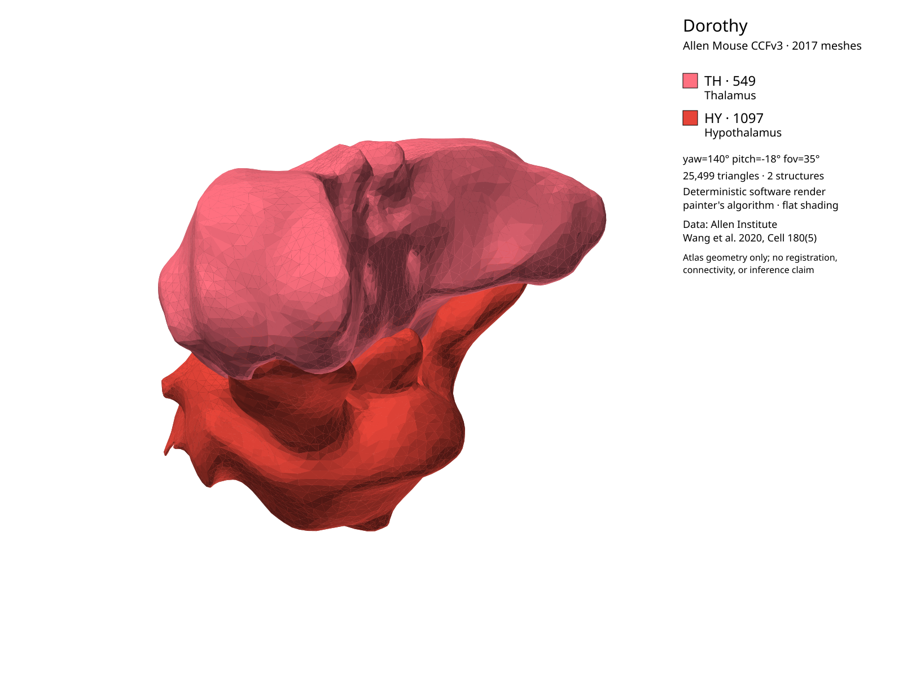

# ZVA-0181 — Dorothy Thalamus Hypothalamus

[Visual archive index](../../README.md) · [Full catalog](../README.md) · [Category: Research figures and measurements](../categories/research-figure.md)

## What this image shows

A focused Dorothy view isolating the thalamus and hypothalamus structures from the Allen reference parcellation. This visual belongs to Dorothy’s inspectable spatial-research program, making reference geometry or a review instrument available for direct inspection.

## Role in Zoe

This visual belongs to Dorothy’s inspectable spatial-research program, making reference geometry or a review instrument available for direct inspection.

## Provenance and evidence boundary

**Provenance:** Zoe render using Allen Institute reference data.

Preclinical mouse-atlas geometry only; not patient anatomy, registration, diagnosis, or treatment evidence.

## File identity

- Archive ID: **ZVA-0181**
- Visual family: **dorothy-thalamus-hypothalamus**
- Dimensions/format: **1600×1200 PNG**
- Frames: **1**
- Bytes: **477,706**
- SHA-256: `97a0427b0fe036f96f078fcdecfd9ef503f5a9f0670f5597340d7e6718f6c276`
- Original file: [Open full resolution](../../images/ZVA-0181.png)

## Source occurrences

Byte-identical copies are archived once while every known source path remains recorded.

| Source repository/collection | Original path | Canonical link |
|---|---|---|
| zoe | `components/graphics-environment-manager/docs/images/dorothy-thalamus-hypothalamus.png` | [Source](https://github.com/Ablation-Tool/zoe/blob/main/components/graphics-environment-manager/docs/images/dorothy-thalamus-hypothalamus.png) |
| zoe | `guiai-lab/docs/images/dorothy-thalamus-hypothalamus.png` | [Source](https://github.com/Ablation-Tool/zoe/blob/main/guiai-lab/docs/images/dorothy-thalamus-hypothalamus.png) |
