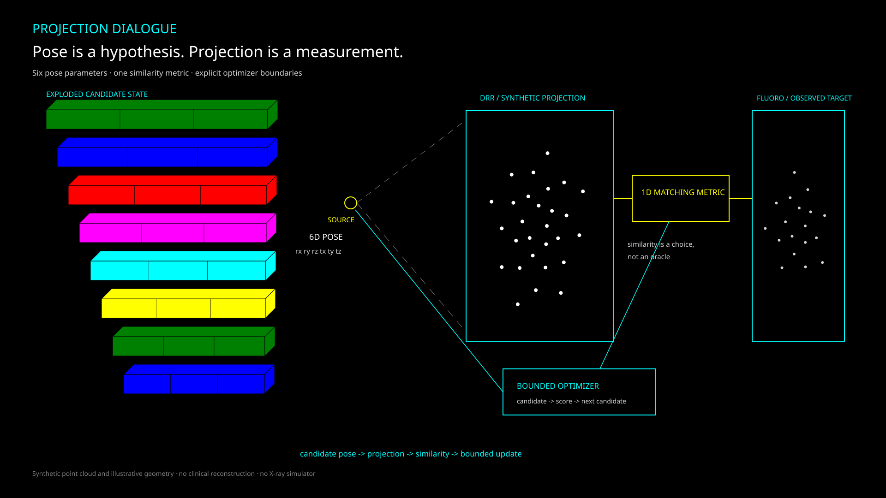

# ZVA-0188 — Projection Dialogue

[Visual archive index](../../README.md) · [Full catalog](../README.md) · [Category: Research figures and measurements](../categories/research-figure.md)

## What this image shows

Projection Dialogue. This figure preserves a measurement, model output, simulation, geometric construction, or research explanation from the Zoe/allgems program.

## Role in Zoe

This figure preserves a measurement, model output, simulation, geometric construction, or research explanation from the Zoe/allgems program.

## Provenance and evidence boundary

**Provenance:** Zoe/allgems project-generated visual.

The image is preserved with its source context; the visual alone does not prove a scientific or operational claim.

## File identity

- Archive ID: **ZVA-0188**
- Visual family: **projection-dialogue**
- Dimensions/format: **1920×1080 PNG**
- Frames: **1**
- Bytes: **108,090**
- SHA-256: `21729eccf89650f18f558d11d32ea336b2e91b7767a61b23be493583e752e00c`
- Original file: [Open full resolution](../../images/ZVA-0188.png)

## Source occurrences

Byte-identical copies are archived once while every known source path remains recorded.

| Source repository/collection | Original path | Canonical link |
|---|---|---|
| zoe | `components/graphics-environment-manager/docs/images/projection-dialogue.png` | [Source](https://github.com/Ablation-Tool/zoe/blob/main/components/graphics-environment-manager/docs/images/projection-dialogue.png) |

## Documented context

### Visual studies and provenance

Source document: `zoe:components/graphics-environment-manager/README.md`

Projection Dialogue

## Related format/size variants

- [ZVA-0189](ZVA-0189.md)
