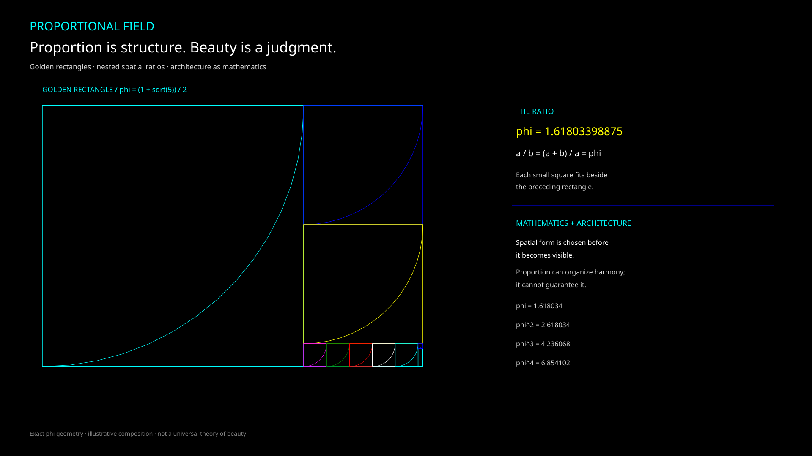

# ZVA-0191 — Proportional Field

[Visual archive index](../../README.md) · [Full catalog](../README.md) · [Category: Research figures and measurements](../categories/research-figure.md)

## What this image shows

Proportional Field is a research figures and measurements asset from the graphics-environment-manager portion of the Zoe/allgems project. This figure preserves a measurement, model output, simulation, geometric construction, or research explanation from the Zoe/allgems program.

## Role in Zoe

This figure preserves a measurement, model output, simulation, geometric construction, or research explanation from the Zoe/allgems program.

## Provenance and evidence boundary

**Provenance:** Zoe/allgems project-generated visual.

The image is preserved with its source context; the visual alone does not prove a scientific or operational claim.

## File identity

- Archive ID: **ZVA-0191**
- Visual family: **proportional-field**
- Dimensions/format: **SVG 1920×1080**
- Frames: **vector/not applicable**
- Bytes: **36,107**
- SHA-256: `61588ffc4f22cf86e7ab2b1f8f1ffd4350bb3cd4bf65aa0f9e32adb96a432641`
- Original file: [Open full resolution](../../images/ZVA-0191.svg)

## Source occurrences

Byte-identical copies are archived once while every known source path remains recorded.

| Source repository/collection | Original path | Canonical link |
|---|---|---|
| zoe | `components/graphics-environment-manager/docs/images/proportional-field.svg` | [Source](https://github.com/Ablation-Tool/zoe/blob/main/components/graphics-environment-manager/docs/images/proportional-field.svg) |

## Related format/size variants

- [ZVA-0190](ZVA-0190.md)
