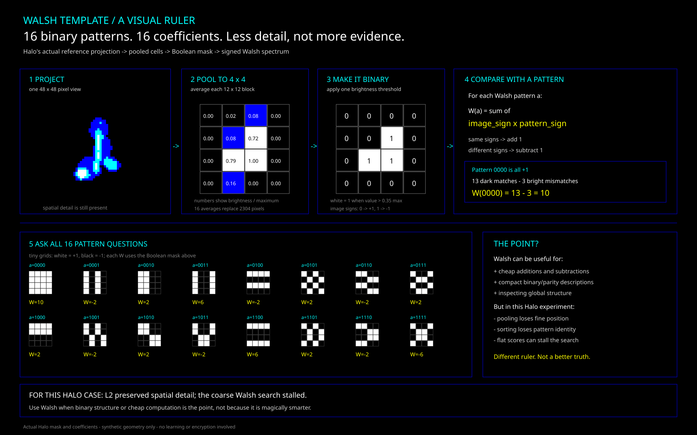

# ZVA-0193 — Walsh Template Explained

[Visual archive index](../../README.md) · [Full catalog](../README.md) · [Category: Research figures and measurements](../categories/research-figure.md)

## What this image shows

Walsh Template Explained is a research figures and measurements asset from the graphics-environment-manager portion of the Zoe/allgems project. This figure preserves a measurement, model output, simulation, geometric construction, or research explanation from the Zoe/allgems program.

## Role in Zoe

This figure preserves a measurement, model output, simulation, geometric construction, or research explanation from the Zoe/allgems program.

## Provenance and evidence boundary

**Provenance:** Zoe/allgems project-generated visual.

The image is preserved with its source context; the visual alone does not prove a scientific or operational claim.

## File identity

- Archive ID: **ZVA-0193**
- Visual family: **walsh-template-explained**
- Dimensions/format: **SVG 1920×1200**
- Frames: **vector/not applicable**
- Bytes: **128,294**
- SHA-256: `4495263070d3d6b306086eee2a3f51ad6e59e6d9723e441ad51945ce6926f3f8`
- Original file: [Open full resolution](../../images/ZVA-0193.svg)

## Source occurrences

Byte-identical copies are archived once while every known source path remains recorded.

| Source repository/collection | Original path | Canonical link |
|---|---|---|
| zoe | `components/graphics-environment-manager/docs/images/walsh-template-explained.svg` | [Source](https://github.com/Ablation-Tool/zoe/blob/main/components/graphics-environment-manager/docs/images/walsh-template-explained.svg) |

## Related format/size variants

- [ZVA-0192](ZVA-0192.md)
