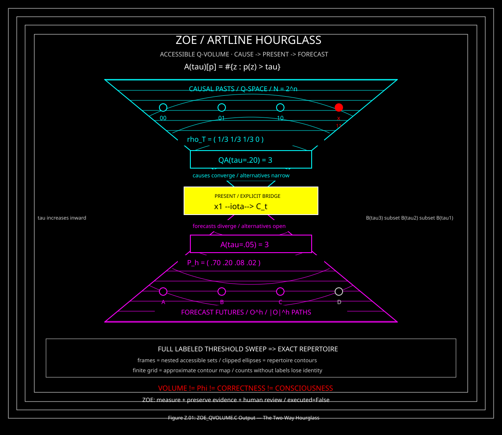

# ZVA-0199 — Zoe Hourglass

[Visual archive index](../../README.md) · [Full catalog](../README.md) · [Category: Research figures and measurements](../categories/research-figure.md)

## What this image shows

Zoe Hourglass is a research figures and measurements asset from the graphics-environment-manager portion of the Zoe/allgems project. This figure preserves a measurement, model output, simulation, geometric construction, or research explanation from the Zoe/allgems program.

## Role in Zoe

This figure preserves a measurement, model output, simulation, geometric construction, or research explanation from the Zoe/allgems program.

## Provenance and evidence boundary

**Provenance:** Zoe/allgems project-generated visual.

The image is preserved with its source context; the visual alone does not prove a scientific or operational claim.

## File identity

- Archive ID: **ZVA-0199**
- Visual family: **zoe-hourglass**
- Dimensions/format: **SVG 1200×1040**
- Frames: **vector/not applicable**
- Bytes: **23,641**
- SHA-256: `a66bc898ee10d6dbd32bd89f45024c45da55f791c27352512cefc77a8968d1d3`
- Original file: [Open full resolution](../../images/ZVA-0199.svg)

## Source occurrences

Byte-identical copies are archived once while every known source path remains recorded.

| Source repository/collection | Original path | Canonical link |
|---|---|---|
| zoe | `components/graphics-environment-manager/examples/hourglass/zoe-hourglass.svg` | [Source](https://github.com/Ablation-Tool/zoe/blob/main/components/graphics-environment-manager/examples/hourglass/zoe-hourglass.svg) |

## Related format/size variants

- [ZVA-0198](ZVA-0198.md)
