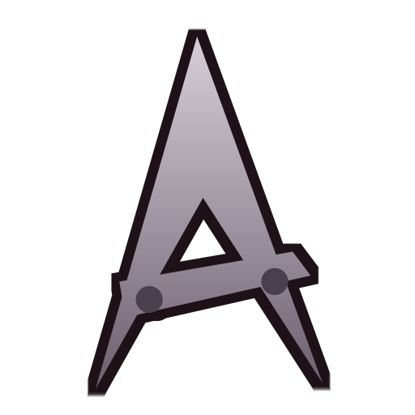

# ZVA-0203 — Ablation Riveted Icon Transparent

[Visual archive index](../../README.md) · [Full catalog](../README.md) · [Category: Identity, emblems, and interface icons](../categories/branding.md)

## What this image shows

A platform-sized Zoe application icon named Ablation Riveted Icon Transparent, exported for the application target at SVG. This visual supports recognition, navigation, application identity, or a cohesive visual language across Zoe and its components.

## Role in Zoe

This visual supports recognition, navigation, application identity, or a cohesive visual language across Zoe and its components.

## Provenance and evidence boundary

**Provenance:** Project identity or interface asset.

Functional and identity artwork does not constitute research evidence.

## File identity

- Archive ID: **ZVA-0203**
- Visual family: **ablation-riveted-icon-transparent**
- Dimensions/format: **SVG 512×512**
- Frames: **vector/not applicable**
- Bytes: **8,882**
- SHA-256: `a86e415af2f51417a2456d7dc956e21178c7a55d6fed3506a3426d96635e96e1`
- Original file: [Open full resolution](../../images/ZVA-0203.svg)

## Source occurrences

Byte-identical copies are archived once while every known source path remains recorded.

| Source repository/collection | Original path | Canonical link |
|---|---|---|
| zoe | `components/graphics-environment-manager/gem/icons/ablation-riveted-icon-transparent.svg` | [Source](https://github.com/Ablation-Tool/zoe/blob/main/components/graphics-environment-manager/gem/icons/ablation-riveted-icon-transparent.svg) |
| zoe | `guiai-lab/build/lib/guiai/icons/ablation-riveted-icon-transparent.svg` | [Source](https://github.com/Ablation-Tool/zoe/blob/main/guiai-lab/build/lib/guiai/icons/ablation-riveted-icon-transparent.svg) |
| zoe | `guiai-lab/guiai/icons/ablation-riveted-icon-transparent.svg` | [Source](https://github.com/Ablation-Tool/zoe/blob/main/guiai-lab/guiai/icons/ablation-riveted-icon-transparent.svg) |
