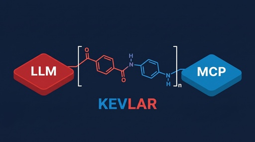

# ZVA-0204 — Kevlar 01

[Visual archive index](../../README.md) · [Full catalog](../README.md) · [Category: Research figures and measurements](../categories/research-figure.md)

## What this image shows

Kevlar 01 is a research figures and measurements asset from the kevlar portion of the Zoe/allgems project. This figure preserves a measurement, model output, simulation, geometric construction, or research explanation from the Zoe/allgems program.

## Role in Zoe

This figure preserves a measurement, model output, simulation, geometric construction, or research explanation from the Zoe/allgems program.

## Provenance and evidence boundary

**Provenance:** Zoe/allgems project-generated visual.

The image is preserved with its source context; the visual alone does not prove a scientific or operational claim.

## File identity

- Archive ID: **ZVA-0204**
- Visual family: **kevlar-01**
- Dimensions/format: **512×285 JPEG**
- Frames: **1**
- Bytes: **25,888**
- SHA-256: `c1e6c1760fe7ec305bfba6edaa1cd5c0e1426475800dc80215c735769f97f5ea`
- Original file: [Open full resolution](../../images/ZVA-0204.jpeg)

## Source occurrences

Byte-identical copies are archived once while every known source path remains recorded.

| Source repository/collection | Original path | Canonical link |
|---|---|---|
| zoe | `components/kevlar/KEVLAR-01.jpeg` | [Source](https://github.com/Ablation-Tool/zoe/blob/main/components/kevlar/KEVLAR-01.jpeg) |
