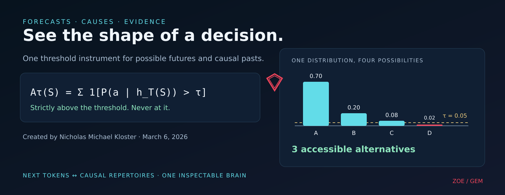

# ZVA-0206 — Accessible Volume Hero

[Visual archive index](../../README.md) · [Full catalog](../README.md) · [Category: Research figures and measurements](../categories/research-figure.md)

## What this image shows

A visual introduction to accessible volume as a shared threshold instrument for forecast futures and explicitly modeled causal pasts. This figure preserves a measurement, model output, simulation, geometric construction, or research explanation from the Zoe/allgems program.

## Role in Zoe

This figure preserves a measurement, model output, simulation, geometric construction, or research explanation from the Zoe/allgems program.

## Provenance and evidence boundary

**Provenance:** Zoe/allgems project-generated visual.

The image is preserved with its source context; the visual alone does not prove a scientific or operational claim.

## File identity

- Archive ID: **ZVA-0206**
- Visual family: **accessible-volume-hero**
- Dimensions/format: **SVG 1600×620**
- Frames: **vector/not applicable**
- Bytes: **3,600**
- SHA-256: `aa5b6be75ea7146c30c751e131d7bcce9039377fc9c2ce23fafe1795d90c6801`
- Original file: [Open full resolution](../../images/ZVA-0206.svg)

## Source occurrences

Byte-identical copies are archived once while every known source path remains recorded.

| Source repository/collection | Original path | Canonical link |
|---|---|---|
| zoe | `components/next-token-predictability/assets/accessible-volume-hero.svg` | [Source](https://github.com/Ablation-Tool/zoe/blob/main/components/next-token-predictability/assets/accessible-volume-hero.svg) |
| next-token | `assets/accessible-volume-hero.svg` | [Source](https://github.com/Ablation-Tool/next-token-predictability/blob/main/assets/accessible-volume-hero.svg) |

## Documented context

### Accessible Volume

Source document: `zoe:components/next-token-predictability/README.md`

Accessible Volume: a shared threshold instrument for forecasts and causal repertoires

**A reproducible way to measure how many possibilities remain open: before a model chooses, while a mechanism constrains its past, and across multiple future steps.**

### Accessible Volume

Source document: `next-token:README.md`

Accessible Volume: a shared threshold instrument for forecasts and causal repertoires

You can understand and use this repository entirely on its own. It also supplies the measurement foundation for Zoe-Autonomy: together, the two projects form the complete self-governing measurement–action architecture. The idea · Evidence · Verify · Zoe-Autonomy · Papers
