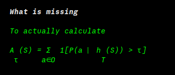

# ZVA-0207 — Accessible Volume Missing Integration

[Visual archive index](../../README.md) · [Full catalog](../README.md) · [Category: Research figures and measurements](../categories/research-figure.md)

## What this image shows

Historical sketch of the accessible-volume equation before numerical integration. This figure preserves a measurement, model output, simulation, geometric construction, or research explanation from the Zoe/allgems program.

## Role in Zoe

This figure preserves a measurement, model output, simulation, geometric construction, or research explanation from the Zoe/allgems program.

## Provenance and evidence boundary

**Provenance:** Zoe/allgems project-generated visual.

The image is preserved with its source context; the visual alone does not prove a scientific or operational claim.

## File identity

- Archive ID: **ZVA-0207**
- Visual family: **accessible-volume-missing-integration**
- Dimensions/format: **345×148 PNG**
- Frames: **1**
- Bytes: **7,183**
- SHA-256: `bf05f04610ade97eb284883b6467e19e4cb49e97d3ea7608e5efacfb046b6d1a`
- Original file: [Open full resolution](../../images/ZVA-0207.png)

## Source occurrences

Byte-identical copies are archived once while every known source path remains recorded.

| Source repository/collection | Original path | Canonical link |
|---|---|---|
| zoe | `components/next-token-predictability/assets/accessible-volume-missing-integration.png` | [Source](https://github.com/Ablation-Tool/zoe/blob/main/components/next-token-predictability/assets/accessible-volume-missing-integration.png) |
| next-token | `assets/accessible-volume-missing-integration.png` | [Source](https://github.com/Ablation-Tool/next-token-predictability/blob/main/assets/accessible-volume-missing-integration.png) |

## Documented context

### Screenshots

Source document: `zoe:components/next-token-predictability/docs/RESEARCH.md`

Historical sketch of the accessible-volume equation before numerical integration

Earlier GEM integration research (superseded) These historical screenshots record the stage before the working Zoe integration. The current implementation, native screenshots, and verification are documented in What is Zoe?.

### Screenshots

Source document: `next-token:docs/RESEARCH.md`

Historical sketch of the accessible-volume equation before numerical integration

Earlier GEM integration research (superseded) These historical screenshots record the stage before the working Zoe integration. The current implementation, native screenshots, and verification are documented in What is Zoe?.
