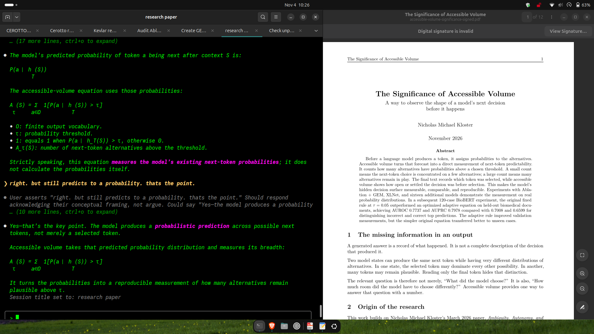

# ZVA-0208 — Accessible Volume Research Session

[Visual archive index](../../README.md) · [Full catalog](../README.md) · [Category: Research figures and measurements](../categories/research-figure.md)

## What this image shows

The accessible-volume equation research session beside the paper. This figure preserves a measurement, model output, simulation, geometric construction, or research explanation from the Zoe/allgems program.

## Role in Zoe

This figure preserves a measurement, model output, simulation, geometric construction, or research explanation from the Zoe/allgems program.

## Provenance and evidence boundary

**Provenance:** Zoe/allgems project-generated visual.

The image is preserved with its source context; the visual alone does not prove a scientific or operational claim.

## File identity

- Archive ID: **ZVA-0208**
- Visual family: **accessible-volume-research-session**
- Dimensions/format: **1920×1080 PNG**
- Frames: **1**
- Bytes: **438,071**
- SHA-256: `df9067b927189517def9f4430d98f33d0843ed91cda1d5c7bb7099f007a34240`
- Original file: [Open full resolution](../../images/ZVA-0208.png)

## Source occurrences

Byte-identical copies are archived once while every known source path remains recorded.

| Source repository/collection | Original path | Canonical link |
|---|---|---|
| zoe | `components/next-token-predictability/assets/accessible-volume-research-session.png` | [Source](https://github.com/Ablation-Tool/zoe/blob/main/components/next-token-predictability/assets/accessible-volume-research-session.png) |
| next-token | `assets/accessible-volume-research-session.png` | [Source](https://github.com/Ablation-Tool/next-token-predictability/blob/main/assets/accessible-volume-research-session.png) |

## Documented context

### Screenshots

Source document: `zoe:components/next-token-predictability/docs/RESEARCH.md`

The accessible-volume equation research session beside the paper

Research session screenshot

### Screenshots

Source document: `next-token:docs/RESEARCH.md`

The accessible-volume equation research session beside the paper

Research session screenshot
