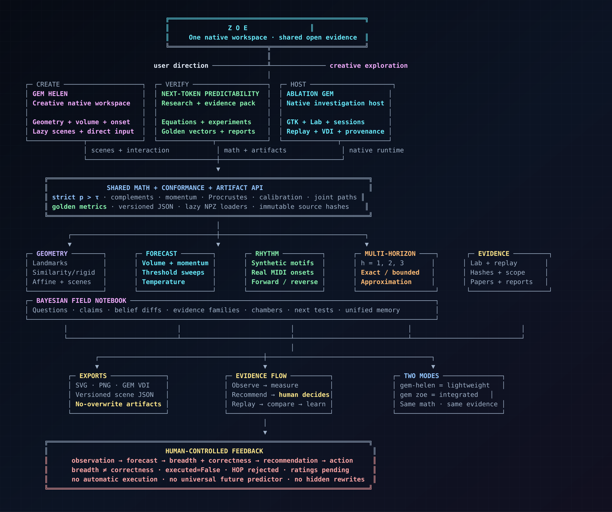

# ZVA-0210 — Master GEM Architecture

[Visual archive index](../../README.md) · [Full catalog](../README.md) · [Category: Mechanism and architecture diagrams](../categories/mechanism-diagram.md)

## What this image shows

The Master GEM architecture map linking forecasts, evidence, memory, geometry, and human/Zoe interaction in one inspectable environment. This diagram explains relationships among components, evidence states, measurements, or decisions without requiring the reader to reconstruct the architecture from code.

## Role in Zoe

This diagram explains relationships among components, evidence states, measurements, or decisions without requiring the reader to reconstruct the architecture from code.

## Provenance and evidence boundary

**Provenance:** Zoe/allgems project-generated visual.

The image is preserved with its source context; the visual alone does not prove a scientific or operational claim.

## File identity

- Archive ID: **ZVA-0210**
- Visual family: **master-gem-architecture**
- Dimensions/format: **2200×1843 PNG**
- Frames: **1**
- Bytes: **607,898**
- SHA-256: `f1493322dd2a73b74f28aaae314e5453a6a299ca450772655c200106e84ac235`
- Original file: [Open full resolution](../../images/ZVA-0210.png)

## Source occurrences

Byte-identical copies are archived once while every known source path remains recorded.

| Source repository/collection | Original path | Canonical link |
|---|---|---|
| zoe | `components/next-token-predictability/assets/master-gem-architecture.png` | [Source](https://github.com/Ablation-Tool/zoe/blob/main/components/next-token-predictability/assets/master-gem-architecture.png) |
| next-token | `assets/master-gem-architecture.png` | [Source](https://github.com/Ablation-Tool/next-token-predictability/blob/main/assets/master-gem-architecture.png) |

## Related format/size variants

- [ZVA-0211](ZVA-0211.md)
