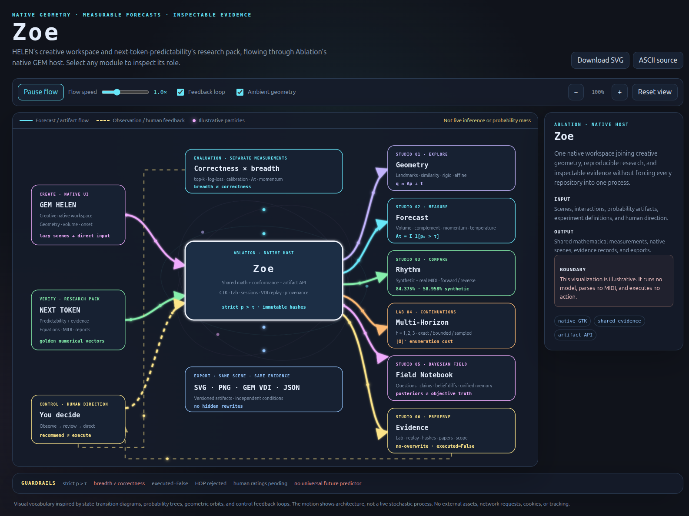

# ZVA-0212 — Master GEM Interactive Preview

[Visual archive index](../../README.md) · [Full catalog](../README.md) · [Category: Mechanism and architecture diagrams](../categories/mechanism-diagram.md)

## What this image shows

Master GEM Interactive Preview is a mechanism and architecture diagrams asset from the next-token-predictability portion of the Zoe/allgems project. This diagram explains relationships among components, evidence states, measurements, or decisions without requiring the reader to reconstruct the architecture from code.

## Role in Zoe

This diagram explains relationships among components, evidence states, measurements, or decisions without requiring the reader to reconstruct the architecture from code.

## Provenance and evidence boundary

**Provenance:** Zoe/allgems project-generated visual.

The image is preserved with its source context; the visual alone does not prove a scientific or operational claim.

## File identity

- Archive ID: **ZVA-0212**
- Visual family: **master-gem-interactive-preview**
- Dimensions/format: **1585×1187 PNG**
- Frames: **1**
- Bytes: **416,727**
- SHA-256: `3af0ac22a74b91eb5b52cf031fe86238a65cc32c12863583577827991d62aec6`
- Original file: [Open full resolution](../../images/ZVA-0212.png)

## Source occurrences

Byte-identical copies are archived once while every known source path remains recorded.

| Source repository/collection | Original path | Canonical link |
|---|---|---|
| zoe | `components/next-token-predictability/assets/master-gem-interactive-preview.png` | [Source](https://github.com/Ablation-Tool/zoe/blob/main/components/next-token-predictability/assets/master-gem-interactive-preview.png) |
| next-token | `assets/master-gem-interactive-preview.png` | [Source](https://github.com/Ablation-Tool/next-token-predictability/blob/main/assets/master-gem-interactive-preview.png) |
