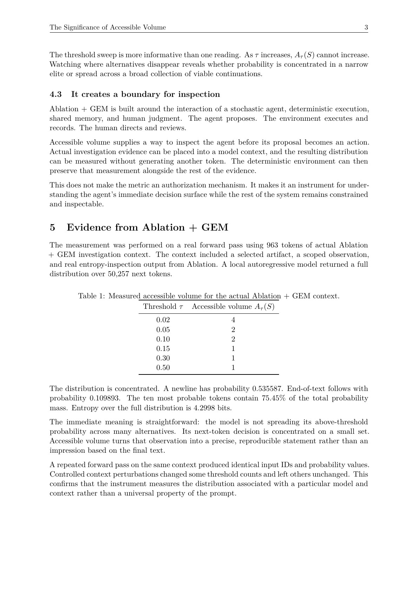

# ZVA-0216 — Page 03

[Visual archive index](../../README.md) · [Full catalog](../README.md) · [Category: Source references and derivative reading copies](../categories/reference.md)

## What this image shows

The Significance of Accessible Volume, page 3. This asset preserves source context or a derivative reading view so that generated interpretations remain distinguishable from their references.

## Role in Zoe

This asset preserves source context or a derivative reading view so that generated interpretations remain distinguishable from their references.

## Provenance and evidence boundary

**Provenance:** Derivative paper-page render.

A reading copy of a paper page, not an independent artwork or new experiment.

## File identity

- Archive ID: **ZVA-0216**
- Visual family: **page-03**
- Dimensions/format: **1191×1684 JPEG**
- Frames: **1**
- Bytes: **346,512**
- SHA-256: `40a875c98cd9ff95c417226303420afa07de339927715c5fc7062cc76f9a3c12`
- Original file: [Open full resolution](../../images/ZVA-0216.jpeg)

## Source occurrences

Byte-identical copies are archived once while every known source path remains recorded.

| Source repository/collection | Original path | Canonical link |
|---|---|---|
| zoe | `components/next-token-predictability/assets/paper-pages/page-03.jpg` | [Source](https://github.com/Ablation-Tool/zoe/blob/main/components/next-token-predictability/assets/paper-pages/page-03.jpg) |
| next-token | `assets/paper-pages/page-03.jpg` | [Source](https://github.com/Ablation-Tool/next-token-predictability/blob/main/assets/paper-pages/page-03.jpg) |

## Documented context

### Screenshots

Source document: `zoe:components/next-token-predictability/docs/RESEARCH.md`

The Significance of Accessible Volume, page 3

### Screenshots

Source document: `next-token:docs/RESEARCH.md`

The Significance of Accessible Volume, page 3
