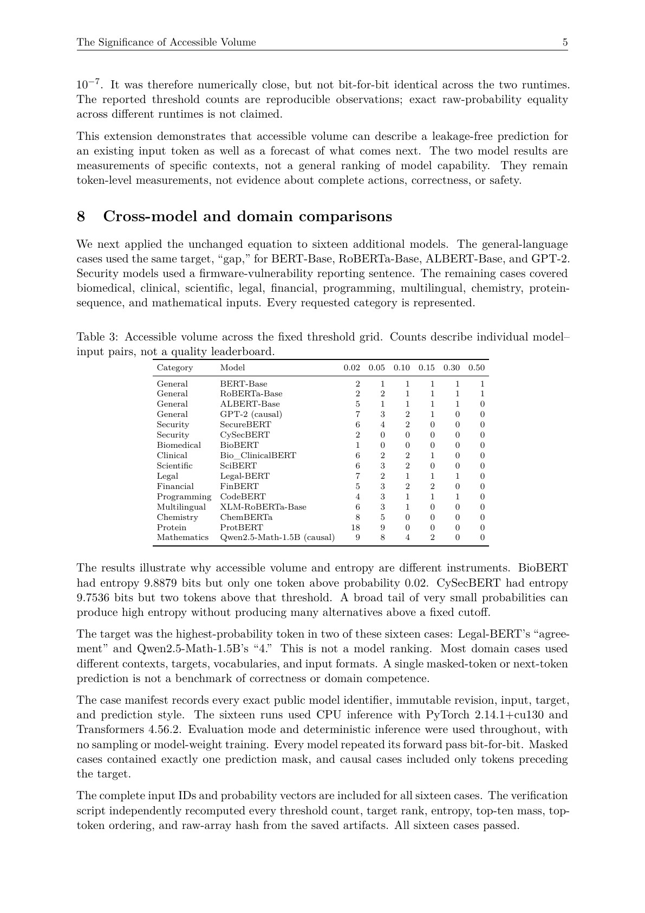

# ZVA-0218 — Page 05

[Visual archive index](../../README.md) · [Full catalog](../README.md) · [Category: Source references and derivative reading copies](../categories/reference.md)

## What this image shows

The Significance of Accessible Volume, page 5. This asset preserves source context or a derivative reading view so that generated interpretations remain distinguishable from their references.

## Role in Zoe

This asset preserves source context or a derivative reading view so that generated interpretations remain distinguishable from their references.

## Provenance and evidence boundary

**Provenance:** Derivative paper-page render.

A reading copy of a paper page, not an independent artwork or new experiment.

## File identity

- Archive ID: **ZVA-0218**
- Visual family: **page-05**
- Dimensions/format: **1191×1684 JPEG**
- Frames: **1**
- Bytes: **419,453**
- SHA-256: `25ef0061350416974ed76a0ee7881cdd5aee2e5d4f2c494e6501af2b22a88af3`
- Original file: [Open full resolution](../../images/ZVA-0218.jpeg)

## Source occurrences

Byte-identical copies are archived once while every known source path remains recorded.

| Source repository/collection | Original path | Canonical link |
|---|---|---|
| zoe | `components/next-token-predictability/assets/paper-pages/page-05.jpg` | [Source](https://github.com/Ablation-Tool/zoe/blob/main/components/next-token-predictability/assets/paper-pages/page-05.jpg) |
| next-token | `assets/paper-pages/page-05.jpg` | [Source](https://github.com/Ablation-Tool/next-token-predictability/blob/main/assets/paper-pages/page-05.jpg) |

## Documented context

### Screenshots

Source document: `zoe:components/next-token-predictability/docs/RESEARCH.md`

The Significance of Accessible Volume, page 5

### Screenshots

Source document: `next-token:docs/RESEARCH.md`

The Significance of Accessible Volume, page 5
