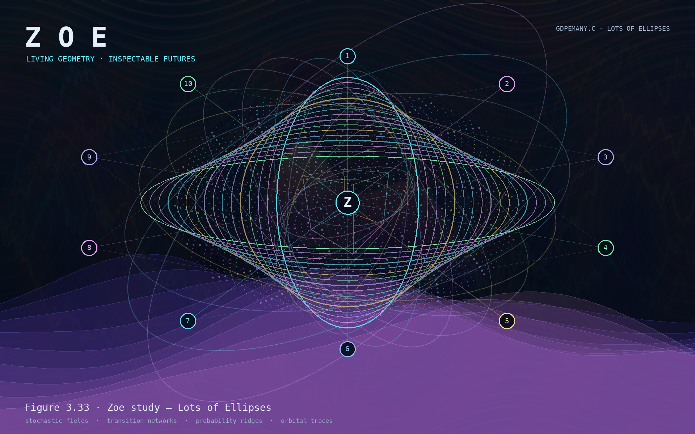

# ZVA-0227 — Zoe Lots Of Ellipses

[Visual archive index](../../README.md) · [Full catalog](../README.md) · [Category: Artwork and generative compositions](../categories/artwork.md)

## What this image shows

The original “Lots of Ellipses” composition: GDPEMANY-inspired ellipse families, stochastic fields, probability ridges, transition networks, and orbital traces combined as creative geometry.

## Role in Zoe

This is part of Zoe’s creative geometry and generative-art practice, preserving the artistic side of the project alongside its scientific instruments.

## Provenance and evidence boundary

**Provenance:** Zoe/allgems project-generated visual.

The image is preserved with its source context; the visual alone does not prove a scientific or operational claim.

## File identity

- Archive ID: **ZVA-0227**
- Visual family: **zoe-lots-of-ellipses**
- Dimensions/format: **1920×1200 PNG**
- Frames: **1**
- Bytes: **1,433,476**
- SHA-256: `9a0afd89ec4f907b9fae8a23cc716fe8b6b504df980de7b8bcdb4b80a42bf629`
- Original file: [Open full resolution](../../images/ZVA-0227.png)

## Source occurrences

Byte-identical copies are archived once while every known source path remains recorded.

| Source repository/collection | Original path | Canonical link |
|---|---|---|
| zoe | `components/next-token-predictability/assets/zoe-lots-of-ellipses.png` | [Source](https://github.com/Ablation-Tool/zoe/blob/main/components/next-token-predictability/assets/zoe-lots-of-ellipses.png) |
| next-token | `assets/zoe-lots-of-ellipses.png` | [Source](https://github.com/Ablation-Tool/next-token-predictability/blob/main/assets/zoe-lots-of-ellipses.png) |

## Documented context

### Explore

Source document: `zoe:components/next-token-predictability/README.md`

Zoe — Lots of Ellipses

**Zoe artwork — Lots of Ellipses:** original geometry inspired by the GEM ellipse family, stochastic fields, and orbital traces.

### Current capabilities

Source document: `zoe:components/next-token-predictability/docs/RESEARCH.md`

Zoe — Lots of Ellipses

**Zoe artwork — Lots of Ellipses:** an original composition built from the GDPEMANY ellipse family, stochastic fields, transition networks, probability ridges, and orbital traces.

### Current capabilities

Source document: `next-token:docs/RESEARCH.md`

Zoe — Lots of Ellipses

**Zoe artwork — Lots of Ellipses:** an original composition built from the GDPEMANY ellipse family, stochastic fields, transition networks, probability ridges, and orbital traces.
