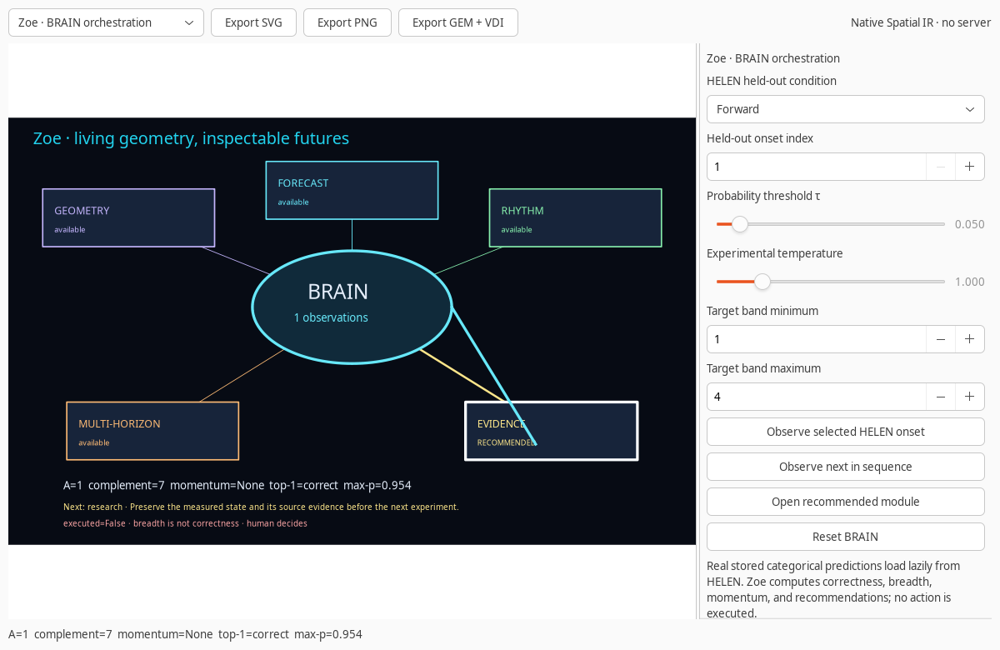

# ZVA-0229 — Zoe Native GUI

[Visual archive index](../../README.md) · [Full catalog](../README.md) · [Category: Native interfaces and application scenes](../categories/interface.md)

## What this image shows

Zoe native BRAIN after a real HELEN observation. This image documents a native, mobile, browser, or desktop interface and its available controls at a particular recorded state.

## Role in Zoe

This image documents a native, mobile, browser, or desktop interface and its available controls at a particular recorded state.

## Provenance and evidence boundary

**Provenance:** Zoe project interface capture.

A screenshot documents the displayed interface state; it is not independent experimental validation.

## File identity

- Archive ID: **ZVA-0229**
- Visual family: **zoe-native-gui**
- Dimensions/format: **1200×780 PNG**
- Frames: **1**
- Bytes: **86,199**
- SHA-256: `69f4ae85cb6acd07cecac84b3223978177e360c05df167e79777c77ef99e9eec`
- Original file: [Open full resolution](../../images/ZVA-0229.png)

## Source occurrences

Byte-identical copies are archived once while every known source path remains recorded.

| Source repository/collection | Original path | Canonical link |
|---|---|---|
| zoe | `components/next-token-predictability/assets/zoe-native-gui.png` | [Source](https://github.com/Ablation-Tool/zoe/blob/main/components/next-token-predictability/assets/zoe-native-gui.png) |
| zoe | `guiai-lab/docs/images/zoe-brain.png` | [Source](https://github.com/Ablation-Tool/zoe/blob/main/guiai-lab/docs/images/zoe-brain.png) |
| next-token | `assets/zoe-native-gui.png` | [Source](https://github.com/Ablation-Tool/next-token-predictability/blob/main/assets/zoe-native-gui.png) |

## Documented context

### See Zoe in action

Source document: `zoe:components/next-token-predictability/docs/RESEARCH.md`

Zoe native BRAIN after a real HELEN observation

These are real application screenshots, not mockups. The concept art remains separate from the working interfaces. **Zoe BRAIN after a real stored HELEN observation:** correctness, accessible volume, complement, momentum, and a deterministic next-module recommendation.

### See Zoe in action

Source document: `next-token:docs/RESEARCH.md`

Zoe native BRAIN after a real HELEN observation

These are real application screenshots, not mockups. The concept art remains separate from the working interfaces. **Zoe BRAIN after a real stored HELEN observation:** correctness, accessible volume, complement, momentum, and a deterministic next-module recommendation.

### Native workbenches

Source document: `zoe:README.md`

Zoe native BRAIN after a stored HELEN observation

### Zoe — living geometry, inspectable futures

Source document: `zoe:guiai-lab/docs/ZOE.md`

Zoe native BRAIN after a real HELEN observation

Zoe unifies **GEM HELEN + MASTER GEM + BRAIN GEM** inside Ablation's native GEM host. HELEN supplies lightweight creative geometry and stored categorical predictions. next-token-predictability supplies research evidence and numerical conformance. Ablation supplies native GTK, Spatial IR, Lab integration, VDI replay, and evidence export. BRAIN is the deterministic observation and recommendation layer; it is not a consciousness claim or an autonomous agent.

### Geometry and evidence

Source document: `zoe:guiai-lab/docs/VISUAL-GUIDES.md`

Zoe BRAIN observation scene

Five-panel causal geometry guide{width=48%} Procrustes landmark playground{width=48%} **Unified architecture and verification · Zoe: living geometry, inspectable futures**
