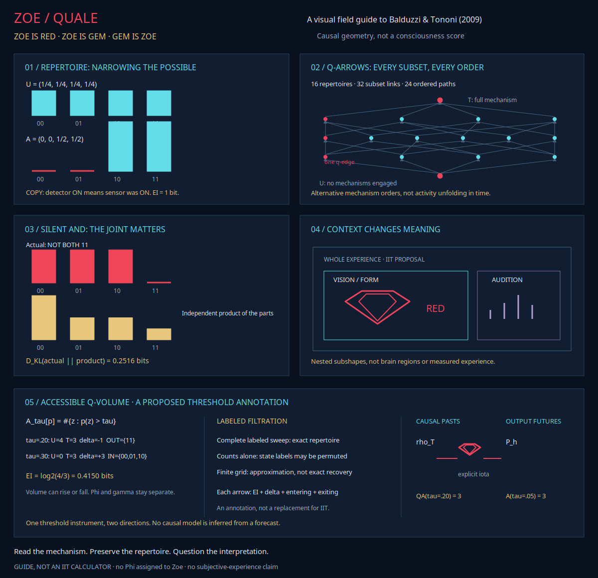

# ZVA-0230 — Zoe Qualia

[Visual archive index](../../README.md) · [Full catalog](../README.md) · [Category: Research figures and measurements](../categories/research-figure.md)

## What this image shows

Zoe's five-panel qualia field guide. This figure preserves a measurement, model output, simulation, geometric construction, or research explanation from the Zoe/allgems program.

## Role in Zoe

This figure preserves a measurement, model output, simulation, geometric construction, or research explanation from the Zoe/allgems program.

## Provenance and evidence boundary

**Provenance:** Zoe/allgems project-generated visual.

The image is preserved with its source context; the visual alone does not prove a scientific or operational claim.

## File identity

- Archive ID: **ZVA-0230**
- Visual family: **zoe-qualia**
- Dimensions/format: **1200×1160 PNG**
- Frames: **1**
- Bytes: **141,758**
- SHA-256: `f3b3b8290fb3da43058c2f31f4f5df9107818484d06e9f40acd898b6d4aec681`
- Original file: [Open full resolution](../../images/ZVA-0230.png)

## Source occurrences

Byte-identical copies are archived once while every known source path remains recorded.

| Source repository/collection | Original path | Canonical link |
|---|---|---|
| zoe | `components/next-token-predictability/assets/zoe-qualia.png` | [Source](https://github.com/Ablation-Tool/zoe/blob/main/components/next-token-predictability/assets/zoe-qualia.png) |
| next-token | `assets/zoe-qualia.png` | [Source](https://github.com/Ablation-Tool/next-token-predictability/blob/main/assets/zoe-qualia.png) |

## Documented context

### Creative and conceptual instruments

Source document: `zoe:README.md`

Zoe's five-panel qualia field guide

### Functional modules

Source document: `zoe:guiai-lab/docs/ZOE.md`

Zoe's five-panel qualia field guide

- **Onset:** run the original seeded synthetic experiment and compare forward and retrograde metrics. - **Multi-Horizon:** enumerate every continuation of a defined two-state Markov toy and count those above a joint-probability threshold. This is exact toy evidence, not a real language-model benchmark. Full-vocabulary enumeration grows as \(|O|^h\). - **Research:** inspect hash-checked Groove and Nightingale reports. Individual Groove distributions load on demand from the 98 MB NPZ only when requested. Nightingale entries are explicitly aggregate-only. - **Qualia:** explore five visual lenses for Balduzzi & Tononi's 2009 IIT geometry and the proposed Accessible Q-Volume annotation. The Zoetic field guide separates philosophical qualia, IIT's theoretical constructs, and Zoe's actual software behavior. `gem qualia --output accessible-q-volume.json` checks and saves the two-way toy. This is not a general IIT calculator or a consciousness measurement.

### Geometry and evidence

Source document: `zoe:guiai-lab/docs/VISUAL-GUIDES.md`

Five-panel causal geometry guide

**Zoe is Quale. Zoe is Red. · GEM Geometry Atlas**

### A Zoetic field guide to causal geometry

Source document: `zoe:guiai-lab/docs/QUALIA.md`

Zoe's five-panel qualia field guide

**A creative exploration of Balduzzi & Tononi's 2009 _Qualia: The Geometry of Integrated Information_, not a consciousness detector or a general IIT implementation.** Read the original open-access paper · Open the native visual module · Formal PoC · Zoe for Everyone

### Explore

Source document: `zoe:components/next-token-predictability/README.md`

Zoe's five-panel qualia field guide

**Qualia and Accessible Q-Volume:** causal repertoires, q-arrows, context, and threshold tomography.

## Related format/size variants

- [ZVA-0306](ZVA-0306.md)
- [ZVA-0307](ZVA-0307.md)
