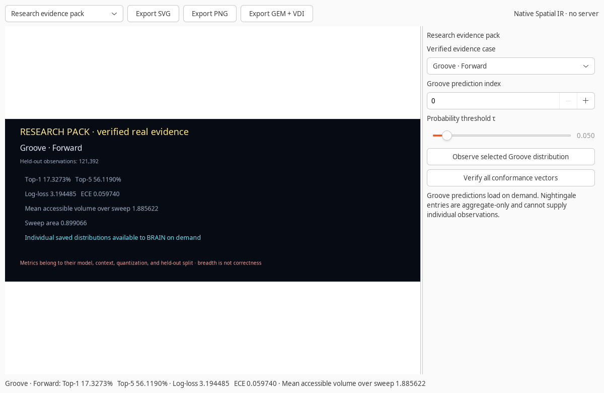

# ZVA-0231 — Zoe Research GUI

[Visual archive index](../../README.md) · [Full catalog](../README.md) · [Category: Native interfaces and application scenes](../categories/interface.md)

## What this image shows

Zoe research evidence pack. This image documents a native, mobile, browser, or desktop interface and its available controls at a particular recorded state.

## Role in Zoe

This image documents a native, mobile, browser, or desktop interface and its available controls at a particular recorded state.

## Provenance and evidence boundary

**Provenance:** Zoe project interface capture.

A screenshot documents the displayed interface state; it is not independent experimental validation.

## File identity

- Archive ID: **ZVA-0231**
- Visual family: **zoe-research-gui**
- Dimensions/format: **1200×780 PNG**
- Frames: **1**
- Bytes: **63,562**
- SHA-256: `ab507e4b10b54fe2584de76bd9f15796f01158369a0ecac9f47858873c5b5b20`
- Original file: [Open full resolution](../../images/ZVA-0231.png)

## Source occurrences

Byte-identical copies are archived once while every known source path remains recorded.

| Source repository/collection | Original path | Canonical link |
|---|---|---|
| zoe | `components/next-token-predictability/assets/zoe-research-gui.png` | [Source](https://github.com/Ablation-Tool/zoe/blob/main/components/next-token-predictability/assets/zoe-research-gui.png) |
| zoe | `guiai-lab/docs/images/zoe-research.png` | [Source](https://github.com/Ablation-Tool/zoe/blob/main/guiai-lab/docs/images/zoe-research.png) |
| next-token | `assets/zoe-research-gui.png` | [Source](https://github.com/Ablation-Tool/next-token-predictability/blob/main/assets/zoe-research-gui.png) |

## Documented context

### See Zoe in action

Source document: `zoe:components/next-token-predictability/docs/RESEARCH.md`

Zoe research evidence pack

**Zoe research evidence:** the hash-checked Groove forward condition with 121,392 held-out predictions and on-demand individual distributions.

### See Zoe in action

Source document: `next-token:docs/RESEARCH.md`

Zoe research evidence pack

**Zoe research evidence:** the hash-checked Groove forward condition with 121,392 held-out predictions and on-demand individual distributions.

### Native workbenches

Source document: `zoe:README.md`

Zoe research evidence pack
