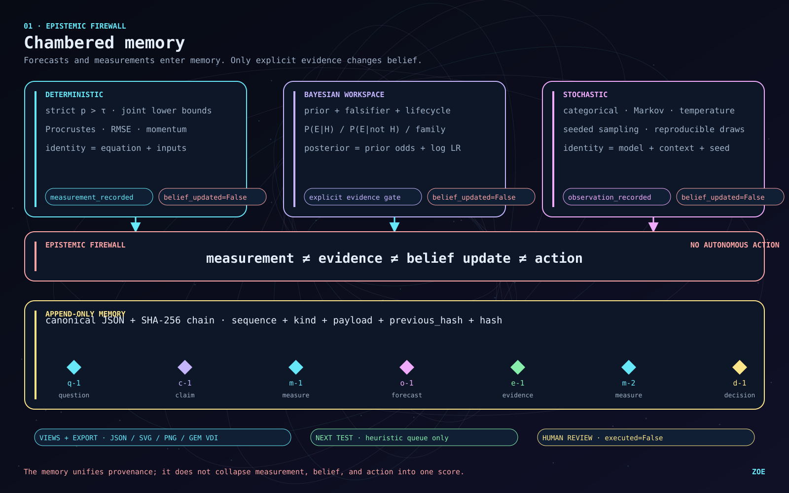

# ZVA-0233 — 01 Epistemic Firewall

[Visual archive index](../../README.md) · [Full catalog](../README.md) · [Category: Mechanism and architecture diagrams](../categories/mechanism-diagram.md)

## What this image shows

01 Epistemic Firewall is a mechanism and architecture diagrams asset from the next-token-predictability portion of the Zoe/allgems project. This diagram explains relationships among components, evidence states, measurements, or decisions without requiring the reader to reconstruct the architecture from code.

## Role in Zoe

This diagram explains relationships among components, evidence states, measurements, or decisions without requiring the reader to reconstruct the architecture from code.

## Provenance and evidence boundary

**Provenance:** Zoe/allgems project-generated visual.

The image is preserved with its source context; the visual alone does not prove a scientific or operational claim.

## File identity

- Archive ID: **ZVA-0233**
- Visual family: **01-epistemic-firewall**
- Dimensions/format: **SVG 1600×1000**
- Frames: **vector/not applicable**
- Bytes: **23,333**
- SHA-256: `89db9de0ab178c660c47147310200e4bbe0109ae8defe6df7635f7e7e1510ed1`
- Original file: [Open full resolution](../../images/ZVA-0233.svg)

## Source occurrences

Byte-identical copies are archived once while every known source path remains recorded.

| Source repository/collection | Original path | Canonical link |
|---|---|---|
| zoe | `components/next-token-predictability/assets/zoe-visuals/01-epistemic-firewall.svg` | [Source](https://github.com/Ablation-Tool/zoe/blob/main/components/next-token-predictability/assets/zoe-visuals/01-epistemic-firewall.svg) |
| next-token | `assets/zoe-visuals/01-epistemic-firewall.svg` | [Source](https://github.com/Ablation-Tool/next-token-predictability/blob/main/assets/zoe-visuals/01-epistemic-firewall.svg) |

## Related format/size variants

- [ZVA-0232](ZVA-0232.md)
- [ZVA-0314](ZVA-0314.md)
- [ZVA-0315](ZVA-0315.md)
