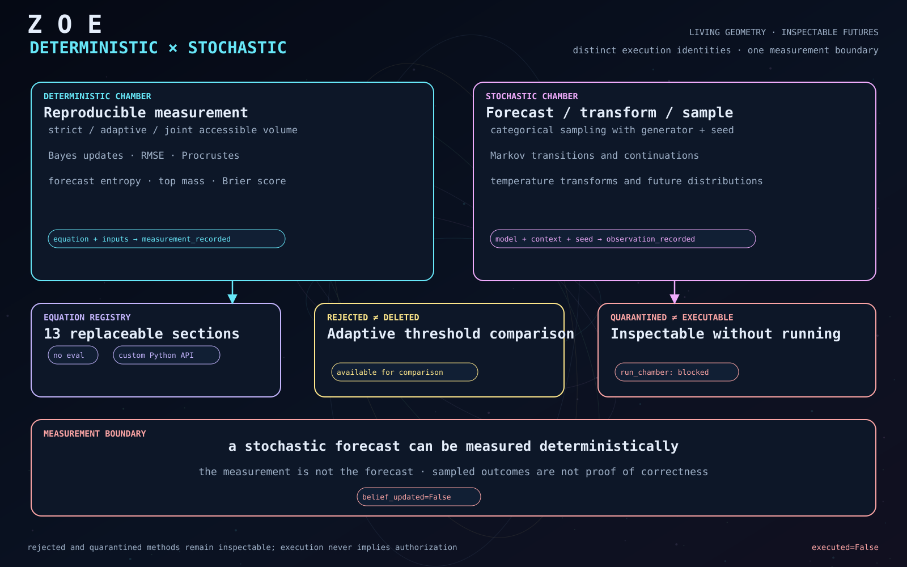

# ZVA-0237 — 03 Chambers

[Visual archive index](../../README.md) · [Full catalog](../README.md) · [Category: Mechanism and architecture diagrams](../categories/mechanism-diagram.md)

## What this image shows

03 Chambers is a mechanism and architecture diagrams asset from the next-token-predictability portion of the Zoe/allgems project. This diagram explains relationships among components, evidence states, measurements, or decisions without requiring the reader to reconstruct the architecture from code.

## Role in Zoe

This diagram explains relationships among components, evidence states, measurements, or decisions without requiring the reader to reconstruct the architecture from code.

## Provenance and evidence boundary

**Provenance:** Zoe/allgems project-generated visual.

The image is preserved with its source context; the visual alone does not prove a scientific or operational claim.

## File identity

- Archive ID: **ZVA-0237**
- Visual family: **03-chambers**
- Dimensions/format: **SVG 1600×1000**
- Frames: **vector/not applicable**
- Bytes: **18,808**
- SHA-256: `3aeb04b3ab41dd59c7905b6289fbc5b52ba775cbfaf3786db312476885857445`
- Original file: [Open full resolution](../../images/ZVA-0237.svg)

## Source occurrences

Byte-identical copies are archived once while every known source path remains recorded.

| Source repository/collection | Original path | Canonical link |
|---|---|---|
| zoe | `components/next-token-predictability/assets/zoe-visuals/03-chambers.svg` | [Source](https://github.com/Ablation-Tool/zoe/blob/main/components/next-token-predictability/assets/zoe-visuals/03-chambers.svg) |
| zoe | `guiai-lab/docs/images/zoe-visuals/03-chambers.svg` | [Source](https://github.com/Ablation-Tool/zoe/blob/main/guiai-lab/docs/images/zoe-visuals/03-chambers.svg) |
| next-token | `assets/zoe-visuals/03-chambers.svg` | [Source](https://github.com/Ablation-Tool/next-token-predictability/blob/main/assets/zoe-visuals/03-chambers.svg) |

## Related format/size variants

- [ZVA-0236](ZVA-0236.md)
