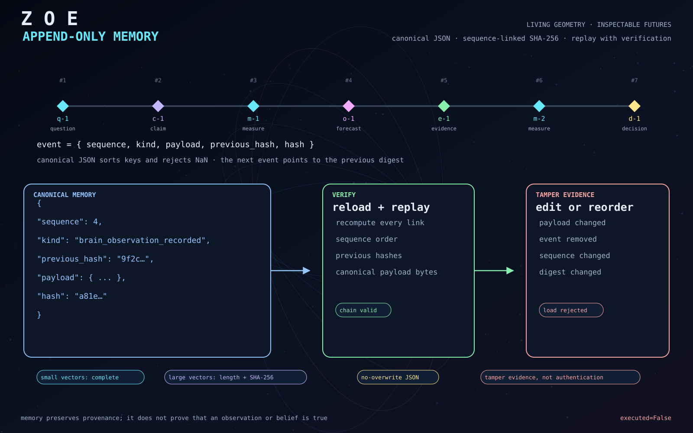

# ZVA-0238 — 04 Memory Chain

[Visual archive index](../../README.md) · [Full catalog](../README.md) · [Category: Mechanism and architecture diagrams](../categories/mechanism-diagram.md)

## What this image shows

Zoe append-only memory. This diagram explains relationships among components, evidence states, measurements, or decisions without requiring the reader to reconstruct the architecture from code.

## Role in Zoe

This diagram explains relationships among components, evidence states, measurements, or decisions without requiring the reader to reconstruct the architecture from code.

## Provenance and evidence boundary

**Provenance:** Zoe/allgems project-generated visual.

The image is preserved with its source context; the visual alone does not prove a scientific or operational claim.

## File identity

- Archive ID: **ZVA-0238**
- Visual family: **04-memory-chain**
- Dimensions/format: **1600×1000 PNG**
- Frames: **1**
- Bytes: **236,836**
- SHA-256: `14afe7b1abd4475b9347b7b01c958e51cbce2be8806378d8478673152520b9ea`
- Original file: [Open full resolution](../../images/ZVA-0238.png)

## Source occurrences

Byte-identical copies are archived once while every known source path remains recorded.

| Source repository/collection | Original path | Canonical link |
|---|---|---|
| zoe | `components/next-token-predictability/assets/zoe-visuals/04-memory-chain.png` | [Source](https://github.com/Ablation-Tool/zoe/blob/main/components/next-token-predictability/assets/zoe-visuals/04-memory-chain.png) |
| zoe | `guiai-lab/docs/images/zoe-visuals/04-memory-chain.png` | [Source](https://github.com/Ablation-Tool/zoe/blob/main/guiai-lab/docs/images/zoe-visuals/04-memory-chain.png) |
| zoe-autonomy | `paper/unified/figures/memory-chain.png` | [Source](https://github.com/Ablation-Tool/Zoe-Autonomy/blob/main/paper/unified/figures/memory-chain.png) |
| next-token | `assets/zoe-visuals/04-memory-chain.png` | [Source](https://github.com/Ablation-Tool/next-token-predictability/blob/main/assets/zoe-visuals/04-memory-chain.png) |
| next-token | `paper/unified/figures/memory-chain.png` | [Source](https://github.com/Ablation-Tool/next-token-predictability/blob/main/paper/unified/figures/memory-chain.png) |
| paper-source-figures | `02-unified-autonomy/figures/memory-chain.png` | [Source](https://github.com/Ablation-Tool/research-papers) |

## Documented context

### Five Zoe mechanisms

Source document: `zoe:README.md`

Zoe append-only memory

3. **Deterministic and stochastic chambers:** reproducible measurements and seeded forecasts have distinct identities and lifecycles. SVG 4. **Append-only memory:** sequence-linked hashes support replay and tamper detection without claiming authentication.

### Functional modules

Source document: `zoe:guiai-lab/docs/ZOE.md`

Zoe append-only memory

3. **Deterministic and stochastic chambers:** reproducible measurements and seeded forecasts have distinct identities and lifecycles. SVG 4. **Append-only memory:** sequence-linked hashes support replay and tamper detection without claiming authentication.

### See Zoe in action

Source document: `zoe:components/next-token-predictability/docs/RESEARCH.md`

Zoe append-only memory

3. **Deterministic and stochastic chambers:** reproducible measurements and seeded forecasts have distinct identities and lifecycles. SVG 4. **Append-only memory:** sequence-linked hashes support replay and tamper detection without claiming authentication.

### See Zoe in action

Source document: `next-token:docs/RESEARCH.md`

Zoe append-only memory

3. **Deterministic and stochastic chambers:** reproducible measurements and seeded forecasts have distinct identities and lifecycles. SVG 4. **Append-only memory:** sequence-linked hashes support replay and tamper detection without claiming authentication.

## Related format/size variants

- [ZVA-0239](ZVA-0239.md)
