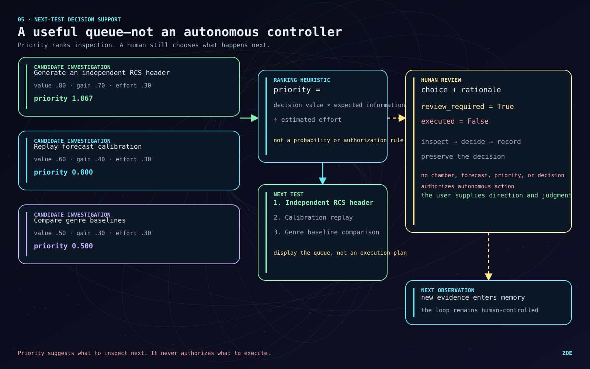

# ZVA-0240 — 05 Next Test

[Visual archive index](../../README.md) · [Full catalog](../README.md) · [Category: Mechanism and architecture diagrams](../categories/mechanism-diagram.md)

## What this image shows

Zoe next useful test. This diagram explains relationships among components, evidence states, measurements, or decisions without requiring the reader to reconstruct the architecture from code.

## Role in Zoe

This diagram explains relationships among components, evidence states, measurements, or decisions without requiring the reader to reconstruct the architecture from code.

## Provenance and evidence boundary

**Provenance:** Zoe/allgems project-generated visual.

The image is preserved with its source context; the visual alone does not prove a scientific or operational claim.

## File identity

- Archive ID: **ZVA-0240**
- Visual family: **05-next-test**
- Dimensions/format: **1600×1000 PNG**
- Frames: **1**
- Bytes: **309,423**
- SHA-256: `d3bba899bf3e2e8c44ea4cd121960f48c58f497c1beceac5aac58d56edc2ced5`
- Original file: [Open full resolution](../../images/ZVA-0240.png)

## Source occurrences

Byte-identical copies are archived once while every known source path remains recorded.

| Source repository/collection | Original path | Canonical link |
|---|---|---|
| zoe | `components/next-token-predictability/assets/zoe-visuals/05-next-test.png` | [Source](https://github.com/Ablation-Tool/zoe/blob/main/components/next-token-predictability/assets/zoe-visuals/05-next-test.png) |
| next-token | `assets/zoe-visuals/05-next-test.png` | [Source](https://github.com/Ablation-Tool/next-token-predictability/blob/main/assets/zoe-visuals/05-next-test.png) |

## Documented context

### Five Zoe mechanisms

Source document: `zoe:README.md`

Zoe next useful test

4. **Append-only memory:** sequence-linked hashes support replay and tamper detection without claiming authentication. SVG 5. **Next useful test:** decision support ranks attention while human review controls execution.

### Functional modules

Source document: `zoe:guiai-lab/docs/ZOE.md`

Zoe next useful test

4. **Append-only memory:** sequence-linked hashes support replay and tamper detection without claiming authentication. SVG 5. **Next useful test:** decision support ranks attention while human review controls execution.

### See Zoe in action

Source document: `zoe:components/next-token-predictability/docs/RESEARCH.md`

Zoe next useful test

4. **Append-only memory:** sequence-linked hashes support replay and tamper detection without claiming authentication. SVG 5. **Next useful test:** decision support ranks attention while human review controls execution.

### See Zoe in action

Source document: `next-token:docs/RESEARCH.md`

Zoe next useful test

4. **Append-only memory:** sequence-linked hashes support replay and tamper detection without claiming authentication. SVG 5. **Next useful test:** decision support ranks attention while human review controls execution.

## Related format/size variants

- [ZVA-0241](ZVA-0241.md)
- [ZVA-0318](ZVA-0318.md)
- [ZVA-0319](ZVA-0319.md)
