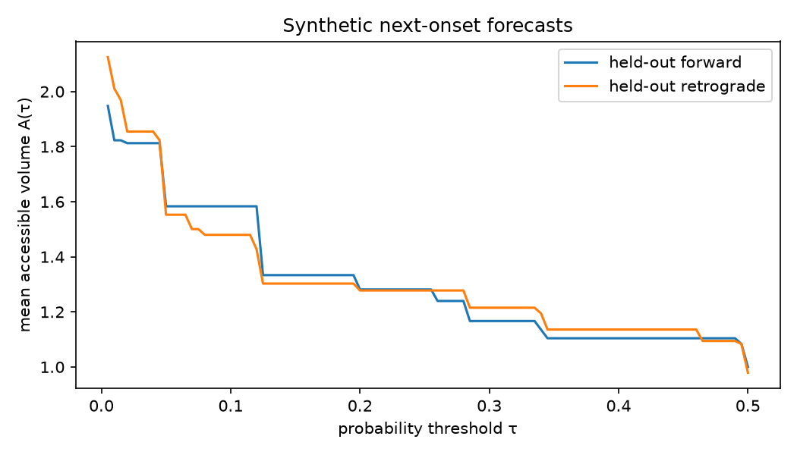

# ZVA-0242 — Rhythm Accessible Volume

[Visual archive index](../../README.md) · [Full catalog](../README.md) · [Category: Research figures and measurements](../categories/research-figure.md)

## What this image shows

Forward and retrograde accessible-volume threshold sweep. This figure preserves a measurement, model output, simulation, geometric construction, or research explanation from the Zoe/allgems program.

## Role in Zoe

This figure preserves a measurement, model output, simulation, geometric construction, or research explanation from the Zoe/allgems program.

## Provenance and evidence boundary

**Provenance:** Zoe/allgems project-generated visual.

The image is preserved with its source context; the visual alone does not prove a scientific or operational claim.

## File identity

- Archive ID: **ZVA-0242**
- Visual family: **rhythm-accessible-volume**
- Dimensions/format: **1050×600 PNG**
- Frames: **1**
- Bytes: **48,743**
- SHA-256: `116fd761324a5dbc97f2956b7d1066386b52c5ae84e0e53078ae8e47e787e452`
- Original file: [Open full resolution](../../images/ZVA-0242.png)

## Source occurrences

Byte-identical copies are archived once while every known source path remains recorded.

| Source repository/collection | Original path | Canonical link |
|---|---|---|
| zoe | `components/next-token-predictability/evidence/rhythm-hop/rhythm-accessible-volume.png` | [Source](https://github.com/Ablation-Tool/zoe/blob/main/components/next-token-predictability/evidence/rhythm-hop/rhythm-accessible-volume.png) |
| zoe-autonomy | `paper/unified/figures/rhythm-synthetic.png` | [Source](https://github.com/Ablation-Tool/Zoe-Autonomy/blob/main/paper/unified/figures/rhythm-synthetic.png) |
| next-token | `evidence/rhythm-hop/rhythm-accessible-volume.png` | [Source](https://github.com/Ablation-Tool/next-token-predictability/blob/main/evidence/rhythm-hop/rhythm-accessible-volume.png) |
| next-token | `paper/unified/figures/rhythm-synthetic.png` | [Source](https://github.com/Ablation-Tool/next-token-predictability/blob/main/paper/unified/figures/rhythm-synthetic.png) |
| paper-source-figures | `02-unified-autonomy/figures/rhythm-synthetic.png` | [Source](https://github.com/Ablation-Tool/research-papers) |

## Documented context

### 2. Modular rhythm and accessible-volume experiment

Source document: `zoe:components/next-token-predictability/evidence/rhythm-hop/README.md`

Forward and retrograde accessible-volume threshold sweep

> **Accessible volume measures the breadth of plausible alternatives, not whether the forecast is right.** A deterministic linear-extrapolation baseline achieved 37.0% forward and 32.8% retrograde. It correctly contributes no accessible-volume measurement because it supplies no alternative distribution.

### 2. Modular rhythm and accessible-volume experiment

Source document: `next-token:evidence/rhythm-hop/README.md`

Forward and retrograde accessible-volume threshold sweep

> **Accessible volume measures the breadth of plausible alternatives, not whether the forecast is right.** A deterministic linear-extrapolation baseline achieved 37.0% forward and 32.8% retrograde. It correctly contributes no accessible-volume measurement because it supplies no alternative distribution.
