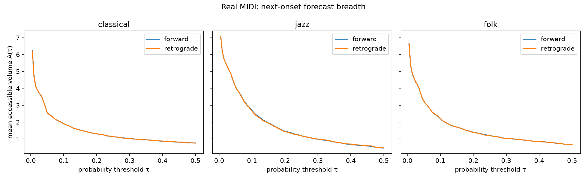

# ZVA-0243 — Real Midi Accessible Volume

[Visual archive index](../../README.md) · [Full catalog](../README.md) · [Category: Research figures and measurements](../categories/research-figure.md)

## What this image shows

Real-MIDI accessible-volume sweep. This figure preserves a measurement, model output, simulation, geometric construction, or research explanation from the Zoe/allgems program.

## Role in Zoe

This figure preserves a measurement, model output, simulation, geometric construction, or research explanation from the Zoe/allgems program.

## Provenance and evidence boundary

**Provenance:** Zoe/allgems project-generated visual.

The image is preserved with its source context; the visual alone does not prove a scientific or operational claim.

## File identity

- Archive ID: **ZVA-0243**
- Visual family: **real-midi-accessible-volume**
- Dimensions/format: **1950×600 PNG**
- Frames: **1**
- Bytes: **97,405**
- SHA-256: `6e569469c121d27a291733bfa30d471be70b2041c9a7a04b974dd70e57ea8c8d`
- Original file: [Open full resolution](../../images/ZVA-0243.png)

## Source occurrences

Byte-identical copies are archived once while every known source path remains recorded.

| Source repository/collection | Original path | Canonical link |
|---|---|---|
| zoe | `components/next-token-predictability/evidence/rhythm-lab/real_midi_accessible_volume.png` | [Source](https://github.com/Ablation-Tool/zoe/blob/main/components/next-token-predictability/evidence/rhythm-lab/real_midi_accessible_volume.png) |
| zoe-autonomy | `paper/unified/figures/nightingale-accessible-volume.png` | [Source](https://github.com/Ablation-Tool/Zoe-Autonomy/blob/main/paper/unified/figures/nightingale-accessible-volume.png) |
| next-token | `evidence/rhythm-lab/real_midi_accessible_volume.png` | [Source](https://github.com/Ablation-Tool/next-token-predictability/blob/main/evidence/rhythm-lab/real_midi_accessible_volume.png) |
| next-token | `paper/unified/figures/nightingale-accessible-volume.png` | [Source](https://github.com/Ablation-Tool/next-token-predictability/blob/main/paper/unified/figures/nightingale-accessible-volume.png) |
| paper-source-figures | `02-unified-autonomy/figures/nightingale-accessible-volume.png` | [Source](https://github.com/Ablation-Tool/research-papers) |

## Documented context

### Evidence and reproducibility

Source document: `zoe:components/next-token-predictability/evidence/rhythm-lab/README.md`

Real-MIDI accessible-volume sweep

- `stimuli.json`: 18 listening-test excerpts with measurements and labels. - `surprise_ratings.html`: browser-based listening and JSON export interface. - `analyze_ratings.py`: Spearman correlation analysis. - `../../scripts/real-midi-experiment.py`: complete experiment implementation.

### Evidence and reproducibility

Source document: `next-token:evidence/rhythm-lab/README.md`

Real-MIDI accessible-volume sweep

- `stimuli.json`: 18 listening-test excerpts with measurements and labels. - `surprise_ratings.html`: browser-based listening and JSON export interface. - `analyze_ratings.py`: Spearman correlation analysis. - `../../scripts/real-midi-experiment.py`: complete experiment implementation.
