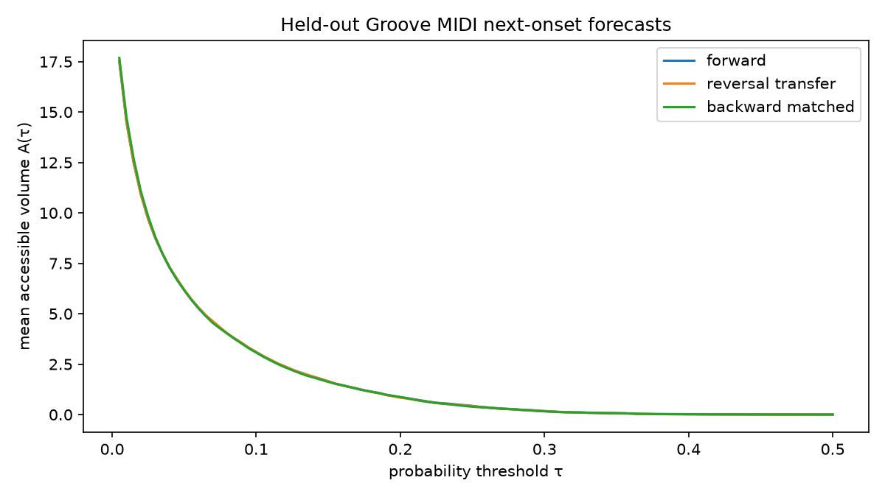

# ZVA-0245 — Accessible Volume

[Visual archive index](../../README.md) · [Full catalog](../README.md) · [Category: Research figures and measurements](../categories/research-figure.md)

## What this image shows

Accessible-volume sweep. This figure preserves a measurement, model output, simulation, geometric construction, or research explanation from the Zoe/allgems program.

## Role in Zoe

This figure preserves a measurement, model output, simulation, geometric construction, or research explanation from the Zoe/allgems program.

## Provenance and evidence boundary

**Provenance:** Zoe/allgems project-generated visual.

The image is preserved with its source context; the visual alone does not prove a scientific or operational claim.

## File identity

- Archive ID: **ZVA-0245**
- Visual family: **accessible-volume**
- Dimensions/format: **1200×675 PNG**
- Frames: **1**
- Bytes: **61,592**
- SHA-256: `0323b1c3b49b2e8a40a9d9366ec05a55ecca12b8d68b8298bd0da4aa8f65aa5a`
- Original file: [Open full resolution](../../images/ZVA-0245.png)

## Source occurrences

Byte-identical copies are archived once while every known source path remains recorded.

| Source repository/collection | Original path | Canonical link |
|---|---|---|
| zoe | `components/next-token-predictability/evidence/rhythm-midi/accessible-volume.png` | [Source](https://github.com/Ablation-Tool/zoe/blob/main/components/next-token-predictability/evidence/rhythm-midi/accessible-volume.png) |
| zoe-autonomy | `paper/unified/figures/groove-accessible-volume.png` | [Source](https://github.com/Ablation-Tool/Zoe-Autonomy/blob/main/paper/unified/figures/groove-accessible-volume.png) |
| next-token | `evidence/rhythm-midi/accessible-volume.png` | [Source](https://github.com/Ablation-Tool/next-token-predictability/blob/main/evidence/rhythm-midi/accessible-volume.png) |
| next-token | `paper/unified/figures/groove-accessible-volume.png` | [Source](https://github.com/Ablation-Tool/next-token-predictability/blob/main/paper/unified/figures/groove-accessible-volume.png) |
| paper-source-figures | `02-unified-autonomy/figures/groove-accessible-volume.png` | [Source](https://github.com/Ablation-Tool/research-papers) |

## Documented context

### Evidence

Source document: `zoe:components/next-token-predictability/evidence/rhythm-midi/README.md`

Accessible-volume sweep

- `sources.json`: all 514 performances and their train/test session assignments. - `predictions.npz`: all three probability distributions, targets, sequence indices, and target positions (94 MB). - `accessible-volume.png`: threshold sweeps for all three conditions. - `predictability-map.png`: accessible volume, confidence, and incorrect predictions over the first 256 beats of a held-out performance.

### Evidence

Source document: `next-token:evidence/rhythm-midi/README.md`

Accessible-volume sweep

- `sources.json`: all 514 performances and their train/test session assignments. - `predictions.npz`: all three probability distributions, targets, sequence indices, and target positions (94 MB). - `accessible-volume.png`: threshold sweeps for all three conditions. - `predictability-map.png`: accessible volume, confidence, and incorrect predictions over the first 256 beats of a held-out performance.
