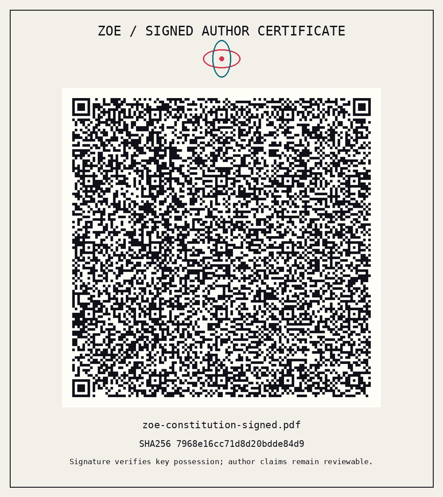

# ZVA-0247 — Zoe Constitution Signed.author

[Visual archive index](../../README.md) · [Full catalog](../README.md) · [Category: Research figures and measurements](../categories/research-figure.md)

## What this image shows

Zoe. This figure preserves a measurement, model output, simulation, geometric construction, or research explanation from the Zoe/allgems program.

## Role in Zoe

This figure preserves a measurement, model output, simulation, geometric construction, or research explanation from the Zoe/allgems program.

## Provenance and evidence boundary

**Provenance:** Zoe/allgems project-generated visual.

The image is preserved with its source context; the visual alone does not prove a scientific or operational claim.

## File identity

- Archive ID: **ZVA-0247**
- Visual family: **zoe-constitution-signed.author**
- Dimensions/format: **1000×1120 PNG**
- Frames: **1**
- Bytes: **252,108**
- SHA-256: `4f30d68108d4d469e5260bda36ca5009c0e9b8d20a3a9a864ad299cde33f6ba7`
- Original file: [Open full resolution](../../images/ZVA-0247.png)

## Source occurrences

Byte-identical copies are archived once while every known source path remains recorded.

| Source repository/collection | Original path | Canonical link |
|---|---|---|
| zoe | `evidence/constitution/zoe-constitution-signed.author.png` | [Source](https://github.com/Ablation-Tool/zoe/blob/main/evidence/constitution/zoe-constitution-signed.author.png) |

## Documented context

### Verifiable authorship

Source document: `zoe:README.md`

Zoe
