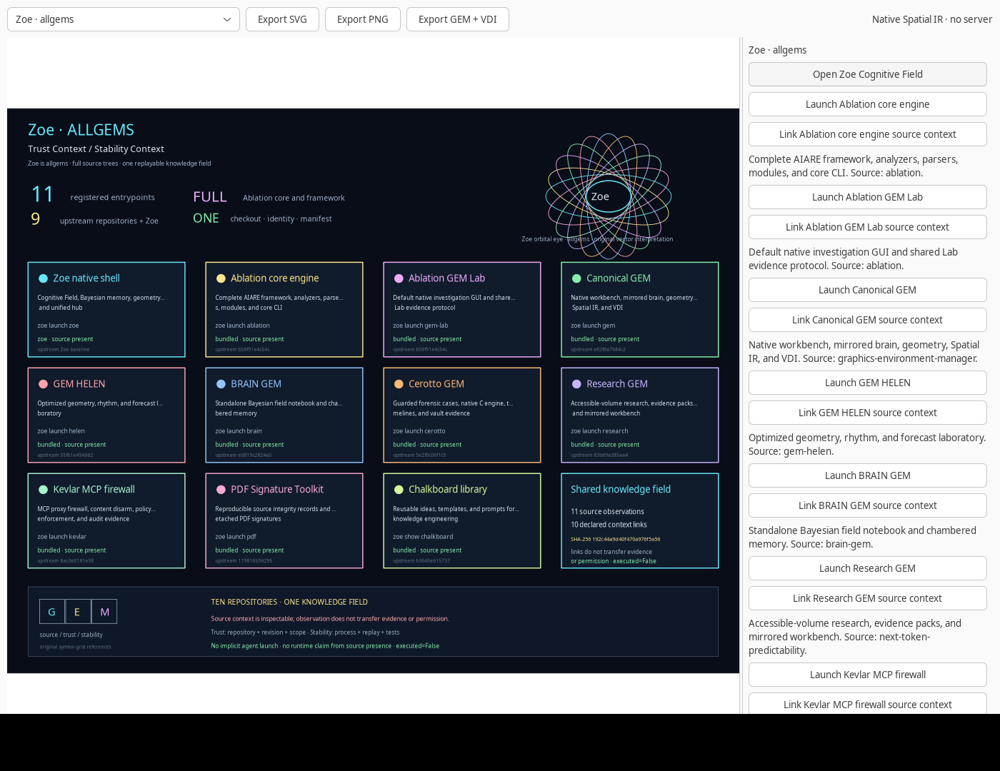

# ZVA-0248 — GEM Unified Native

[Visual archive index](../../README.md) · [Full catalog](../README.md) · [Category: Native interfaces and application scenes](../categories/interface.md)

## What this image shows

Native unified hub. This image documents a native, mobile, browser, or desktop interface and its available controls at a particular recorded state.

## Role in Zoe

This image documents a native, mobile, browser, or desktop interface and its available controls at a particular recorded state.

## Provenance and evidence boundary

**Provenance:** Zoe project interface capture.

A screenshot documents the displayed interface state; it is not independent experimental validation.

## File identity

- Archive ID: **ZVA-0248**
- Visual family: **gem-unified-native**
- Dimensions/format: **1400×1080 PNG**
- Frames: **1**
- Bytes: **213,343**
- SHA-256: `4bf9c170ac26892e243fb5b8d19575553434a20444386d1729095970caf6b469`
- Original file: [Open full resolution](../../images/ZVA-0248.png)

## Source occurrences

Byte-identical copies are archived once while every known source path remains recorded.

| Source repository/collection | Original path | Canonical link |
|---|---|---|
| zoe | `guiai-lab/docs/images/gem-unified-native.png` | [Source](https://github.com/Ablation-Tool/zoe/blob/main/guiai-lab/docs/images/gem-unified-native.png) |

## Documented context

### Emblem and symbol references

Source document: `zoe:guiai-lab/docs/UNIFIED.md`

Native unified hub

`assets/branding/zoe-eye.png` is the primary Zoe emblem, generated from the user-supplied eye/orbital reference by `assets/branding/render_eye.py`. The earlier `orbital-emblem.png` remains the source of the orbital motif. The G, E, and M symbol-grid references are preserved under `assets/branding/references/` with their source filenames in `assets/branding/PROVENANCE.md`. Historical recognition for Gary Kildall and the original Digital Research contributors is recorded in `NOTICE`.
