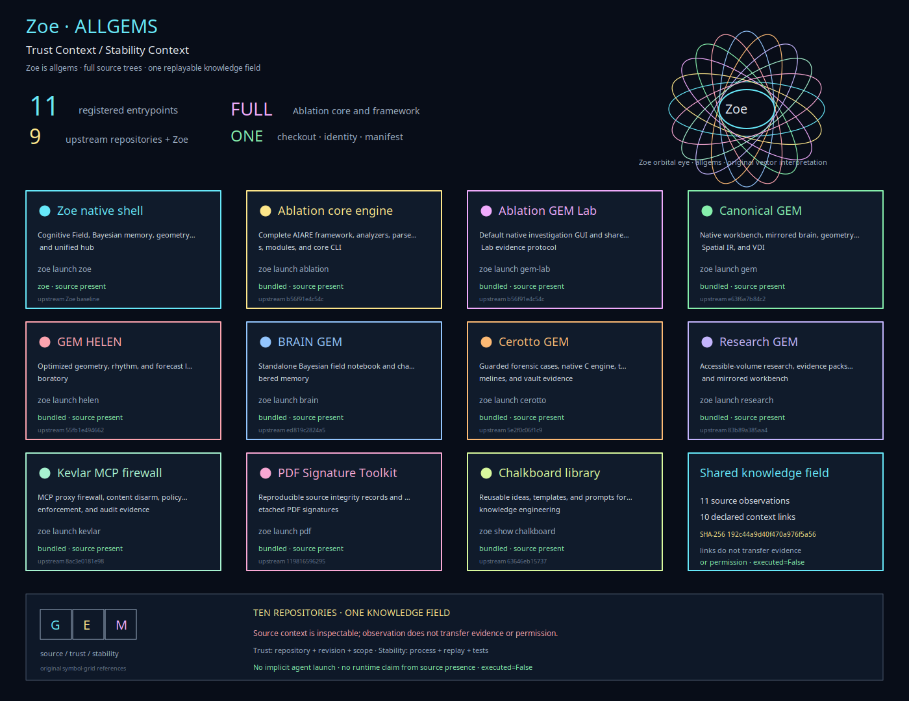

# ZVA-0249 — GEM Unified

[Visual archive index](../../README.md) · [Full catalog](../README.md) · [Category: Research figures and measurements](../categories/research-figure.md)

## What this image shows

Zoe allgems knowledge-engineering hub. This figure preserves a measurement, model output, simulation, geometric construction, or research explanation from the Zoe/allgems program.

## Role in Zoe

This figure preserves a measurement, model output, simulation, geometric construction, or research explanation from the Zoe/allgems program.

## Provenance and evidence boundary

**Provenance:** Zoe/allgems project-generated visual.

The image is preserved with its source context; the visual alone does not prove a scientific or operational claim.

## File identity

- Archive ID: **ZVA-0249**
- Visual family: **gem-unified**
- Dimensions/format: **1400×1080 PNG**
- Frames: **1**
- Bytes: **185,957**
- SHA-256: `783bcd5d6548adbeb34a3774972c36ea97a07c96342a13ec6845d8c86b642ba9`
- Original file: [Open full resolution](../../images/ZVA-0249.png)

## Source occurrences

Byte-identical copies are archived once while every known source path remains recorded.

| Source repository/collection | Original path | Canonical link |
|---|---|---|
| zoe | `guiai-lab/docs/images/gem-unified.png` | [Source](https://github.com/Ablation-Tool/zoe/blob/main/guiai-lab/docs/images/gem-unified.png) |

## Documented context

### Zoe

Source document: `zoe:README.md`

Zoe allgems knowledge-engineering hub

**Research priority #1 is Dorothy:** inspectable spatial research and evidence tools supporting the long-term brain-cancer research mission. Dorothy currently provides Allen mouse-atlas geometry and preclinical research infrastructure—not a cure, diagnosis, treatment, patient registration, or surgical authority. Current Work · Quick start · Capabilities · Architecture · Verification

### Geometry and evidence

Source document: `zoe:guiai-lab/docs/VISUAL-GUIDES.md`

Unified knowledge-engineering hub

Five-panel causal geometry guide{width=48%} Procrustes landmark playground{width=48%} **Unified architecture and verification · Zoe: living geometry, inspectable futures**

## Related format/size variants

- [ZVA-0250](ZVA-0250.md)
