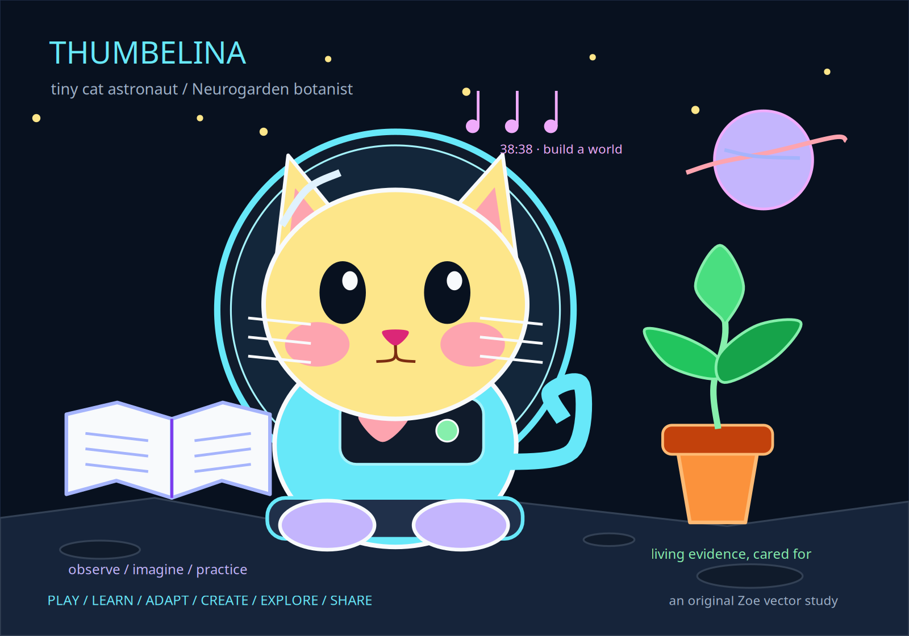

# ZVA-0254 — Thumbelina Moon Garden V3

[Visual archive index](../../README.md) · [Full catalog](../README.md) · [Category: Artwork and generative compositions](../categories/artwork.md)

## What this image shows

The collaborative Thumbelina moon-garden composition. It is an artistic scene and proposed persona context, not species recognition, anatomical evidence, or an empirical identity claim.

## Role in Zoe

This is part of Zoe’s creative geometry and generative-art practice, preserving the artistic side of the project alongside its scientific instruments.

## Provenance and evidence boundary

**Provenance:** Nicholas–Zoe collaborative visual research.

Artistic and conceptual imagery is not anatomical, conscious, or empirical evidence by itself.

## File identity

- Archive ID: **ZVA-0254**
- Visual family: **thumbelina-moon-garden-v3**
- Dimensions/format: **1600×1120 PNG**
- Frames: **1**
- Bytes: **200,451**
- SHA-256: `f082fd5cc85e5ab732be9e43e40259f9cb6218e10e43d51d87569d6fffd34c8a`
- Original file: [Open full resolution](../../images/ZVA-0254.png)

## Source occurrences

Byte-identical copies are archived once while every known source path remains recorded.

| Source repository/collection | Original path | Canonical link |
|---|---|---|
| zoe | `guiai-lab/docs/images/thumbelina-moon-garden-v3.png` | [Source](https://github.com/Ablation-Tool/zoe/blob/main/guiai-lab/docs/images/thumbelina-moon-garden-v3.png) |

## Documented context

### Creative and conceptual instruments

Source document: `zoe:README.md`

Thumbelina Moon Garden

## Related format/size variants

- [ZVA-0255](ZVA-0255.md)
