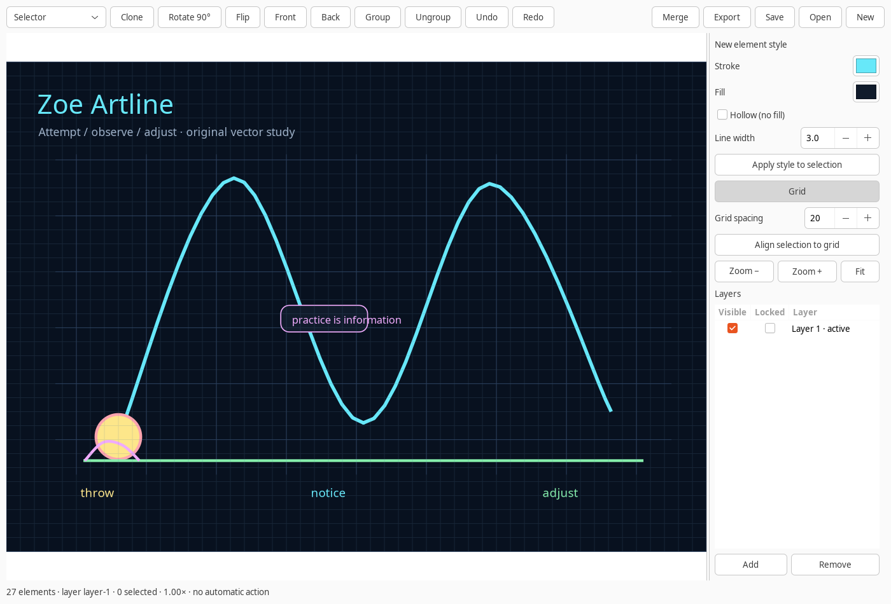

# ZVA-0256 — Zoe Artline Native

[Visual archive index](../../README.md) · [Full catalog](../README.md) · [Category: Artwork and generative compositions](../categories/artwork.md)

## What this image shows

The actual native Artline window, showing the vector study beside its interactive controls and preserving the distinction between the application and its exported scene. This is part of Zoe’s creative geometry and generative-art practice, preserving the artistic side of the project alongside its scientific instruments.

## Role in Zoe

This is part of Zoe’s creative geometry and generative-art practice, preserving the artistic side of the project alongside its scientific instruments.

## Provenance and evidence boundary

**Provenance:** Zoe project interface capture.

A screenshot documents the displayed interface state; it is not independent experimental validation.

## File identity

- Archive ID: **ZVA-0256**
- Visual family: **zoe-artline-native**
- Dimensions/format: **1400×950 PNG**
- Frames: **1**
- Bytes: **87,823**
- SHA-256: `52b47f83643641dee5cf5a5f3693f6c772c9d5672455cfc97b9609479054188e`
- Original file: [Open full resolution](../../images/ZVA-0256.png)

## Source occurrences

Byte-identical copies are archived once while every known source path remains recorded.

| Source repository/collection | Original path | Canonical link |
|---|---|---|
| zoe | `guiai-lab/docs/images/zoe-artline-native.png` | [Source](https://github.com/Ablation-Tool/zoe/blob/main/guiai-lab/docs/images/zoe-artline-native.png) |

## Documented context

### Native workbenches

Source document: `zoe:README.md`

Zoe Artline vector workbench
