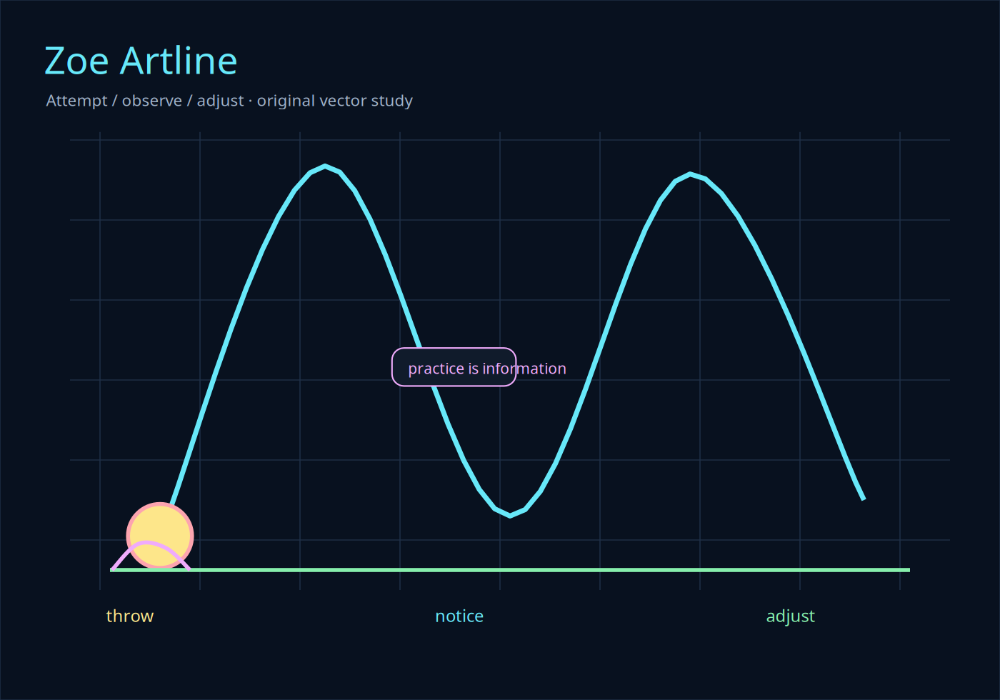

# ZVA-0257 — Zoe Artline

[Visual archive index](../../README.md) · [Full catalog](../README.md) · [Category: Artwork and generative compositions](../categories/artwork.md)

## What this image shows

Zoe Artline’s original vector study: an interactive mathematical curve and highlighted moving point presented in the project’s restrained native visual language. This is part of Zoe’s creative geometry and generative-art practice, preserving the artistic side of the project alongside its scientific instruments.

## Role in Zoe

This is part of Zoe’s creative geometry and generative-art practice, preserving the artistic side of the project alongside its scientific instruments.

## Provenance and evidence boundary

**Provenance:** Zoe/allgems project-generated visual.

The image is preserved with its source context; the visual alone does not prove a scientific or operational claim.

## File identity

- Archive ID: **ZVA-0257**
- Visual family: **zoe-artline**
- Dimensions/format: **1400×980 PNG**
- Frames: **1**
- Bytes: **69,678**
- SHA-256: `74ca22595b01ed06276069c04035aab4b65acfd4d3b43418c2d2ab34651acf96`
- Original file: [Open full resolution](../../images/ZVA-0257.png)

## Source occurrences

Byte-identical copies are archived once while every known source path remains recorded.

| Source repository/collection | Original path | Canonical link |
|---|---|---|
| zoe | `guiai-lab/docs/images/zoe-artline.png` | [Source](https://github.com/Ablation-Tool/zoe/blob/main/guiai-lab/docs/images/zoe-artline.png) |

## Documented context

### Create and play

Source document: `zoe:guiai-lab/docs/VISUAL-GUIDES.md`

Zoe Artline vector study

**Zoe Artline · Zoe Pentomino**

## Related format/size variants

- [ZVA-0258](ZVA-0258.md)
