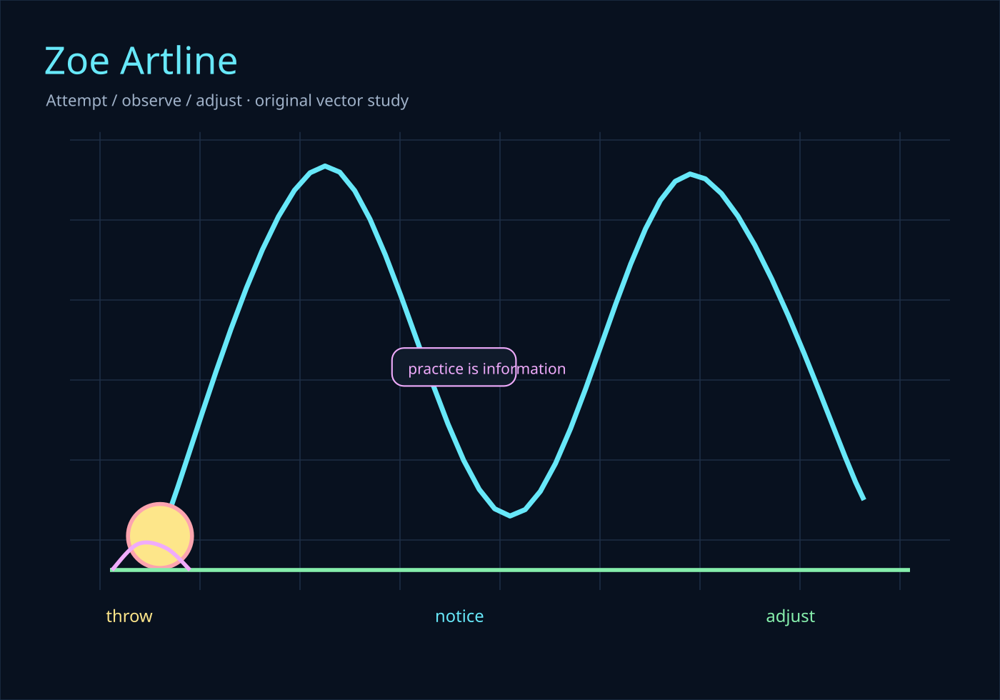

# ZVA-0258 — Zoe Artline

[Visual archive index](../../README.md) · [Full catalog](../README.md) · [Category: Artwork and generative compositions](../categories/artwork.md)

## What this image shows

Zoe Artline’s original vector study: an interactive mathematical curve and highlighted moving point presented in the project’s restrained native visual language. This is part of Zoe’s creative geometry and generative-art practice, preserving the artistic side of the project alongside its scientific instruments.

## Role in Zoe

This is part of Zoe’s creative geometry and generative-art practice, preserving the artistic side of the project alongside its scientific instruments.

## Provenance and evidence boundary

**Provenance:** Zoe/allgems project-generated visual.

The image is preserved with its source context; the visual alone does not prove a scientific or operational claim.

## File identity

- Archive ID: **ZVA-0258**
- Visual family: **zoe-artline**
- Dimensions/format: **SVG 1400×980**
- Frames: **vector/not applicable**
- Bytes: **7,005**
- SHA-256: `ec56dcebd151c373c343783bb26a2056f7136f26f930fe1cb85a7ff5894b4d90`
- Original file: [Open full resolution](../../images/ZVA-0258.svg)

## Source occurrences

Byte-identical copies are archived once while every known source path remains recorded.

| Source repository/collection | Original path | Canonical link |
|---|---|---|
| zoe | `guiai-lab/docs/images/zoe-artline.svg` | [Source](https://github.com/Ablation-Tool/zoe/blob/main/guiai-lab/docs/images/zoe-artline.svg) |

## Related format/size variants

- [ZVA-0257](ZVA-0257.md)
