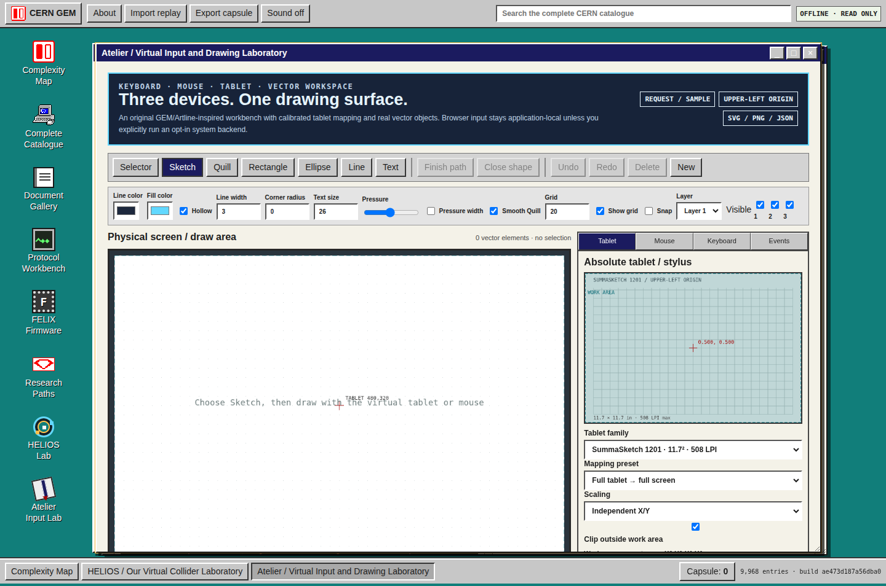

# ZVA-0259 — Zoe Atelier

[Visual archive index](../../README.md) · [Full catalog](../README.md) · [Category: Native interfaces and application scenes](../categories/interface.md)

## What this image shows

Atelier virtual input and drawing laboratory. This visual belongs to Zoe’s CERN/source-evidence program, helping a reader inspect a corpus, protocol, replay, virtual system, or process boundary.

## Role in Zoe

This visual belongs to Zoe’s CERN/source-evidence program, helping a reader inspect a corpus, protocol, replay, virtual system, or process boundary.

## Provenance and evidence boundary

**Provenance:** Zoe/allgems project-generated visual.

The image is preserved with its source context; the visual alone does not prove a scientific or operational claim.

## File identity

- Archive ID: **ZVA-0259**
- Visual family: **zoe-atelier**
- Dimensions/format: **1440×954 PNG**
- Frames: **1**
- Bytes: **178,606**
- SHA-256: `ca870888f677d6e775af220e7e126c7b129c192ce7c284a269febf70641af484`
- Original file: [Open full resolution](../../images/ZVA-0259.png)

## Source occurrences

Byte-identical copies are archived once while every known source path remains recorded.

| Source repository/collection | Original path | Canonical link |
|---|---|---|
| zoe | `guiai-lab/docs/images/zoe-atelier.png` | [Source](https://github.com/Ablation-Tool/zoe/blob/main/guiai-lab/docs/images/zoe-atelier.png) |
| zoe-autonomy | `paper/unified/figures/zoe-atelier.png` | [Source](https://github.com/Ablation-Tool/Zoe-Autonomy/blob/main/paper/unified/figures/zoe-atelier.png) |
| next-token | `paper/unified/figures/zoe-atelier.png` | [Source](https://github.com/Ablation-Tool/next-token-predictability/blob/main/paper/unified/figures/zoe-atelier.png) |
| paper-source-figures | `02-unified-autonomy/figures/zoe-atelier.png` | [Source](https://github.com/Ablation-Tool/research-papers) |

## Documented context

### Start and open

Source document: `zoe:guiai-lab/docs/ZOE_WORKBENCH.md`

Atelier virtual input and drawing laboratory

The checkout defaults to `/media/cowboy/research/GEM/cern-console`. Override it with `ZOE_CERN_CONSOLE` or the direct CLI's `--checkout` option.
