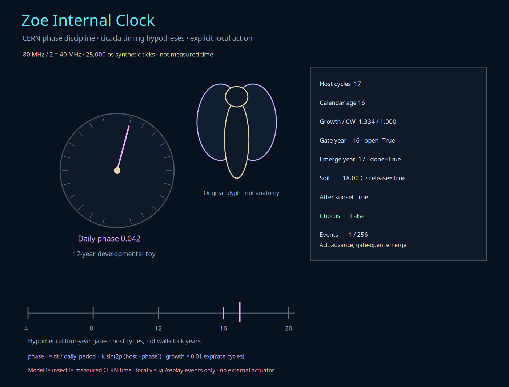

# ZVA-0261 — Zoe Cicada

[Visual archive index](../../README.md) · [Full catalog](../README.md) · [Category: Research figures and measurements](../categories/research-figure.md)

## What this image shows

Zoe Internal Clock. This figure preserves a measurement, model output, simulation, geometric construction, or research explanation from the Zoe/allgems program.

## Role in Zoe

This figure preserves a measurement, model output, simulation, geometric construction, or research explanation from the Zoe/allgems program.

## Provenance and evidence boundary

**Provenance:** Zoe/allgems project-generated visual.

The image is preserved with its source context; the visual alone does not prove a scientific or operational claim.

## File identity

- Archive ID: **ZVA-0261**
- Visual family: **zoe-cicada**
- Dimensions/format: **1400×1064 PNG**
- Frames: **1**
- Bytes: **118,562**
- SHA-256: `108bed312a37a2e05c7ddb375556d9b9bdbf69efd0604ea8b9d62e8b538a73bb`
- Original file: [Open full resolution](../../images/ZVA-0261.png)

## Source occurrences

Byte-identical copies are archived once while every known source path remains recorded.

| Source repository/collection | Original path | Canonical link |
|---|---|---|
| zoe | `guiai-lab/docs/images/zoe-cicada.png` | [Source](https://github.com/Ablation-Tool/zoe/blob/main/guiai-lab/docs/images/zoe-cicada.png) |
| zoe-autonomy | `paper/unified/figures/cicada.png` | [Source](https://github.com/Ablation-Tool/Zoe-Autonomy/blob/main/paper/unified/figures/cicada.png) |
| next-token | `paper/unified/figures/cicada.png` | [Source](https://github.com/Ablation-Tool/next-token-predictability/blob/main/paper/unified/figures/cicada.png) |
| paper-source-figures | `02-unified-autonomy/figures/cicada.png` | [Source](https://github.com/Ablation-Tool/research-papers) |

## Documented context

### Native workbenches

Source document: `zoe:README.md`

Zoe Internal Clock

### Create and play

Source document: `zoe:guiai-lab/docs/VISUAL-GUIDES.md`

CERN ticks and cicada timing hypotheses

Pentomino regions and legal cube permutations{width=72%} **Zoe Internal Clock**

### Zoe Internal Clock

Source document: `zoe:guiai-lab/docs/CICADA.md`

Zoe Internal Clock

**Zoe Internal Clock is a deterministic timing instrument informed by CERN clock distribution and the biological study of cicada timing.** It advances a local state machine—`advance`, `daily-pulse`, `gate-open`, `emerge`, and `chorus`—without a reasoning loop. “Acting without thinking” here means exactly that: after an explicit **Act** action, a bounded local timer advances visual/replay events. It does not mean autonomous hardware control, an AI decision process, a biological measurement, or a claim that the software is a cicada.

## Related format/size variants

- [ZVA-0262](ZVA-0262.md)
