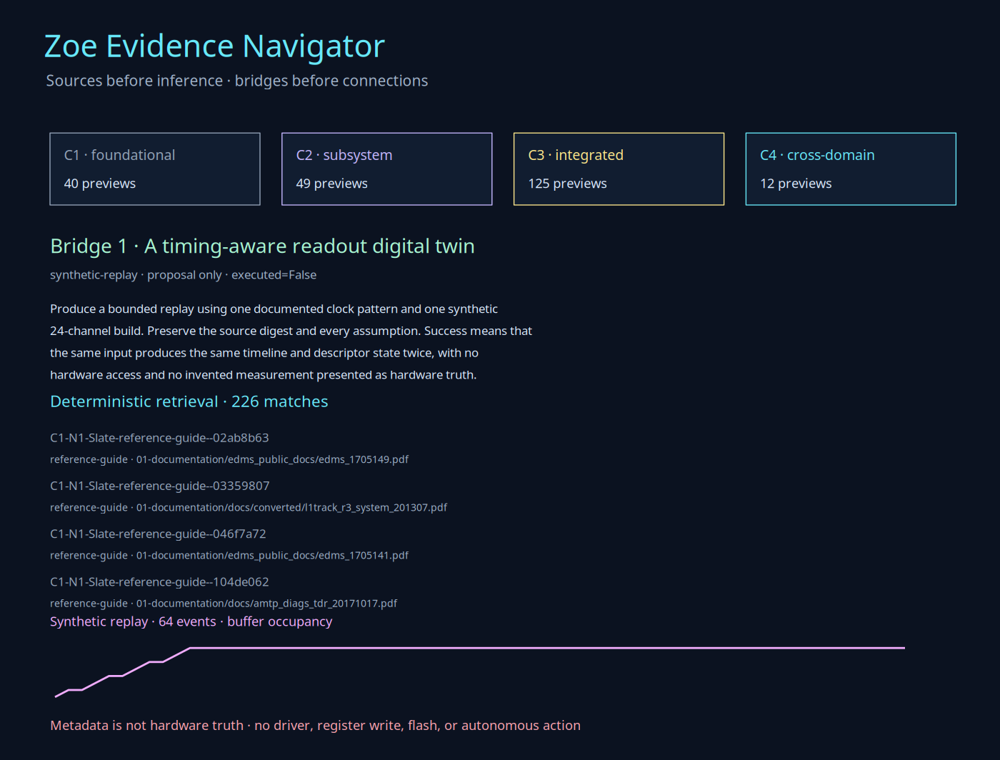

# ZVA-0269 — Zoe Evidence

[Visual archive index](../../README.md) · [Full catalog](../README.md) · [Category: Research figures and measurements](../categories/research-figure.md)

<a href="../../images/ZVA-0269.png"></a>

## What this image shows

Zoe Evidence Navigator. This figure preserves a measurement, model output, simulation, geometric construction, or research explanation from the Zoe/allgems program.

## Role in Zoe

This figure preserves a measurement, model output, simulation, geometric construction, or research explanation from the Zoe/allgems program.

## Provenance and evidence boundary

**Provenance:** Zoe/allgems project-generated visual.

The image is preserved with its source context; the visual alone does not prove a scientific or operational claim.

## File identity

- Archive ID: **ZVA-0269**
- Visual family: **zoe-evidence**
- Dimensions/format: **1400×1064 PNG**
- Frames: **1**
- Bytes: **125,905**
- SHA-256: `072a688d77c696bbf30b7d6e5d553be2cae5292d596e7c60e1f14ed5da20cd38`
- Original file: [Open full resolution](../../images/ZVA-0269.png)

## Source occurrences

Byte-identical copies are archived once while every known source path remains recorded.

| Source repository/collection | Original path | Canonical link |
|---|---|---|
| zoe | `guiai-lab/docs/images/zoe-evidence.png` | [Source](https://github.com/Ablation-Tool/zoe/blob/main/guiai-lab/docs/images/zoe-evidence.png) |
| zoe-autonomy | `paper/unified/figures/zoe-evidence.png` | [Source](https://github.com/Ablation-Tool/Zoe-Autonomy/blob/main/paper/unified/figures/zoe-evidence.png) |
| next-token | `paper/unified/figures/zoe-evidence.png` | [Source](https://github.com/Ablation-Tool/next-token-predictability/blob/main/paper/unified/figures/zoe-evidence.png) |
| paper-source-figures | `02-unified-autonomy/figures/zoe-evidence.png` | [Source](https://github.com/Ablation-Tool/research-papers) |


## Documented context

### Native workbenches

Source document: `zoe:README.md`

Zoe Evidence Navigator

### Practice and adaptation

Source document: `zoe:guiai-lab/docs/VISUAL-GUIDES.md`

Source-first evidence bridges and bounded replay

Executive clarity, luxury restraint, and enterprise evidence{width=72%} **Zoe Evidence Navigator**

### Verification

Source document: `zoe:guiai-lab/docs/EVIDENCE.md`

Zoe Evidence Navigator

python -m unittest stress.evidence_stress -v ``` The suite covers schema and distribution checks, source and preview hashes, compatibility links, all seven bridges, missing-evidence behavior, curriculum prompts, protocol schemas, observation controls, shadow retrieval, replay and audio determinism, CLI workflows, and native load/verify/replay/export paths.

## Related format/size variants

- [ZVA-0270](ZVA-0270.md)
