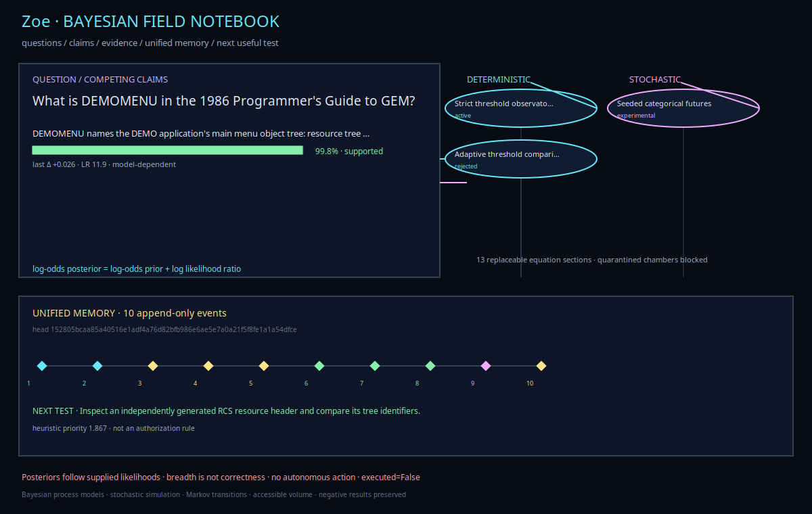

# ZVA-0271 — Zoe Field Notebook

[Visual archive index](../../README.md) · [Full catalog](../README.md) · [Category: Research figures and measurements](../categories/research-figure.md)

## What this image shows

Zoe Bayesian field notebook. This figure preserves a measurement, model output, simulation, geometric construction, or research explanation from the Zoe/allgems program.

## Role in Zoe

This figure preserves a measurement, model output, simulation, geometric construction, or research explanation from the Zoe/allgems program.

## Provenance and evidence boundary

**Provenance:** Zoe/allgems project-generated visual.

The image is preserved with its source context; the visual alone does not prove a scientific or operational claim.

## File identity

- Archive ID: **ZVA-0271**
- Visual family: **zoe-field-notebook**
- Dimensions/format: **1200×760 PNG**
- Frames: **1**
- Bytes: **83,542**
- SHA-256: `75af3f71fbc4d4dc2da62b9d0508c8bcec3b08b3be25db47f1e28777a433a1a4`
- Original file: [Open full resolution](../../images/ZVA-0271.png)

## Source occurrences

Byte-identical copies are archived once while every known source path remains recorded.

| Source repository/collection | Original path | Canonical link |
|---|---|---|
| zoe | `guiai-lab/docs/images/zoe-field-notebook.png` | [Source](https://github.com/Ablation-Tool/zoe/blob/main/guiai-lab/docs/images/zoe-field-notebook.png) |
| zoe-autonomy | `paper/unified/figures/field-notebook.png` | [Source](https://github.com/Ablation-Tool/Zoe-Autonomy/blob/main/paper/unified/figures/field-notebook.png) |
| next-token | `paper/unified/figures/field-notebook.png` | [Source](https://github.com/Ablation-Tool/next-token-predictability/blob/main/paper/unified/figures/field-notebook.png) |
| paper-source-figures | `02-unified-autonomy/figures/field-notebook.png` | [Source](https://github.com/Ablation-Tool/research-papers) |

## Documented context

### Native workbenches

Source document: `zoe:README.md`

Zoe Bayesian field notebook

### Functional modules

Source document: `zoe:guiai-lab/docs/ZOE.md`

Zoe Bayesian field notebook

ntifies the next module to inspect; it never executes an action. - **FELIX:** index local FELIX builds, correlate exact-build Ablation findings, replay observations into Zoe's Cognitive Field, refresh corpus evidence, inspect TIM and LCB/STAR HDL context, and export Spatial IR, observation JSON, or deterministic stereo WAV. Open **Zoe × FELIX** in the native module selector or run `PYTHONPATH=guiai-lab python -m guiai.gem zoe --module felix --output zoe-felix.svg`. Use `gem felix-hdl --output recovered-hdl` to recover clean LCB and STAR/Flink source files with provenance indexes. Filesystem observation is not hardware telemetry and host-source capabilities never authorize execution. The default root is `/media/cowboy/research/CERN/Boutique`; legacy `/media/cowboy/research/CERN` paths remain supported through compatibility symlinks, with logical source names and catalogue verification preserved. - **Field notebook:** organize questions, competing binary claims, explicit Bayesian evidence updates, deterministic and stochastic chambers, next-test priorities, and decisions in one append-only hash-chained memory. BRAIN observations are preserved without automatically changing belief. The equation registry includes strict, normalized, adaptive, joint, momentum, temperature, Markov, timing, geometry, and categorical-sampling sections; custom equations can be registered without `eval`.

### Explore

Source document: `zoe:components/next-token-predictability/README.md`

Zoe Bayesian field notebook

Interface and artwork gallery **Bayesian field notebook:** explicit evidence, belief diffs, chambers, and append-only memory.

### See Zoe in action

Source document: `zoe:components/next-token-predictability/docs/RESEARCH.md`

Zoe Bayesian field notebook

**Zoe Bayesian field notebook:** the worked DEMOMENU example with posterior evidence updates, chamber states, append-only memory, and a next-test recommendation.

### See Zoe in action

Source document: `next-token:docs/RESEARCH.md`

Zoe Bayesian field notebook

**Zoe Bayesian field notebook:** the worked DEMOMENU example with posterior evidence updates, chamber states, append-only memory, and a next-test recommendation.

## Related format/size variants

- [ZVA-0226](ZVA-0226.md)
