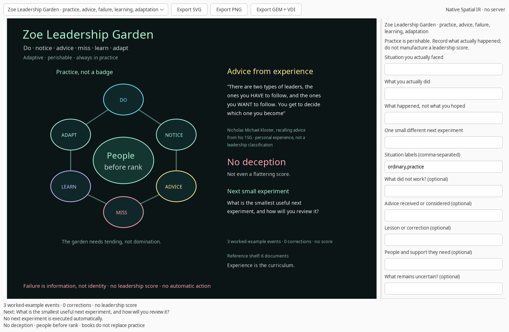

# ZVA-0273 — Zoe Leadership Native

[Visual archive index](../../README.md) · [Full catalog](../README.md) · [Category: Native interfaces and application scenes](../categories/interface.md)

## What this image shows

Native Zoe Leadership Garden. This image documents a native, mobile, browser, or desktop interface and its available controls at a particular recorded state.

## Role in Zoe

This image documents a native, mobile, browser, or desktop interface and its available controls at a particular recorded state.

## Provenance and evidence boundary

**Provenance:** Zoe project interface capture.

A screenshot documents the displayed interface state; it is not independent experimental validation.

## File identity

- Archive ID: **ZVA-0273**
- Visual family: **zoe-leadership-native**
- Dimensions/format: **1440×940 PNG**
- Frames: **1**
- Bytes: **160,133**
- SHA-256: `4ef01486b38cc5b6e4a327fbd67df64f4a7dfdfc7a0de4d089298c9cafbbef2d`
- Original file: [Open full resolution](../../images/ZVA-0273.png)

## Source occurrences

Byte-identical copies are archived once while every known source path remains recorded.

| Source repository/collection | Original path | Canonical link |
|---|---|---|
| zoe | `guiai-lab/docs/images/zoe-leadership-native.png` | [Source](https://github.com/Ablation-Tool/zoe/blob/main/guiai-lab/docs/images/zoe-leadership-native.png) |

## Documented context

### Verification

Source document: `zoe:guiai-lab/docs/LEADERSHIP.md`

Native Zoe Leadership Garden

The suite covers practice prompts, frame variation, required fields, append-only corrections, source-chain integrity, tamper detection, no-overwrite saves, real PDF metadata and text snippets, CLI workflows, native recording/loading/saving/library inspection, failed-load preservation, and SVG/PNG/GEM scenes. The supplied PDFs and personal note remain external; optional local-evidence tests are skipped if they are unavailable.
