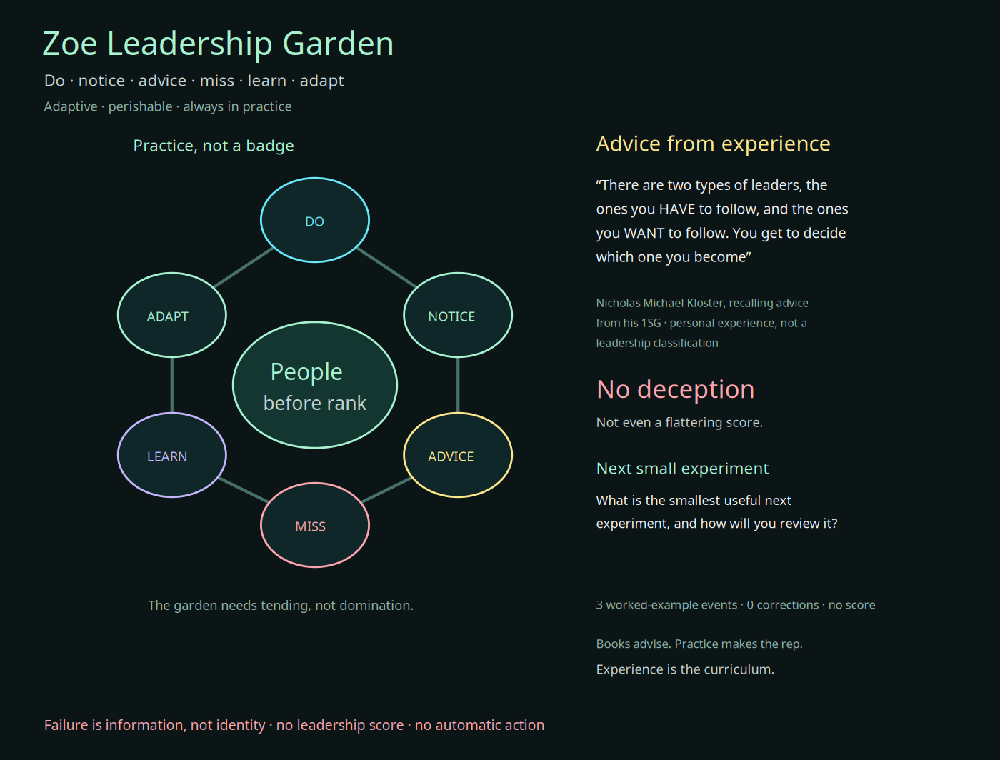

# ZVA-0274 — Zoe Leadership

[Visual archive index](../../README.md) · [Full catalog](../README.md) · [Category: Research figures and measurements](../categories/research-figure.md)

<a href="../../images/ZVA-0274.png"></a>

## What this image shows

Zoe Leadership Garden. This figure preserves a measurement, model output, simulation, geometric construction, or research explanation from the Zoe/allgems program.

## Role in Zoe

This figure preserves a measurement, model output, simulation, geometric construction, or research explanation from the Zoe/allgems program.

## Provenance and evidence boundary

**Provenance:** Zoe/allgems project-generated visual.

The image is preserved with its source context; the visual alone does not prove a scientific or operational claim.

## File identity

- Archive ID: **ZVA-0274**
- Visual family: **zoe-leadership**
- Dimensions/format: **1400×1064 PNG**
- Frames: **1**
- Bytes: **159,555**
- SHA-256: `39dd2da7f7471cc412a47895cfbcfb31842b0dbcad68f6e922f630ff9df785da`
- Original file: [Open full resolution](../../images/ZVA-0274.png)

## Source occurrences

Byte-identical copies are archived once while every known source path remains recorded.

| Source repository/collection | Original path | Canonical link |
|---|---|---|
| zoe | `guiai-lab/docs/images/zoe-leadership.png` | [Source](https://github.com/Ablation-Tool/zoe/blob/main/guiai-lab/docs/images/zoe-leadership.png) |


## Documented context

### Creative and conceptual instruments

Source document: `zoe:README.md`

Zoe Leadership Garden

### Practice and adaptation

Source document: `zoe:guiai-lab/docs/VISUAL-GUIDES.md`

Practice, advice, failure, learning, and adaptation

**Zoe Leadership Garden**

### Verification

Source document: `zoe:guiai-lab/docs/LEADERSHIP.md`

Zoe Leadership Garden

python -m unittest stress.leadership_stress -v ``` The suite covers practice prompts, frame variation, required fields, append-only corrections, source-chain integrity, tamper detection, no-overwrite saves, real PDF metadata and text snippets, CLI workflows, native recording/loading/saving/library inspection, failed-load preservation, and SVG/PNG/GEM scenes. The supplied PDFs and personal note remain external; optional local-evidence tests are skipped if they are unavailable.

## Related format/size variants

- [ZVA-0275](ZVA-0275.md)
