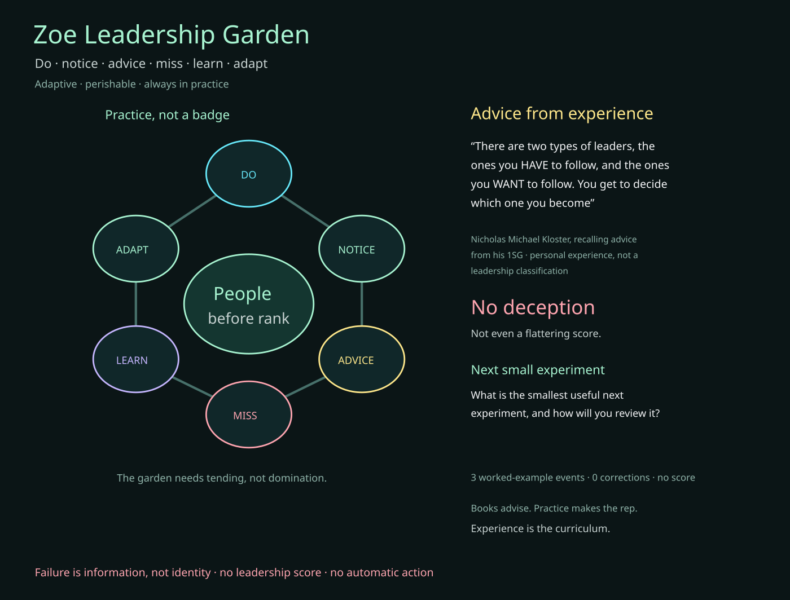

# ZVA-0275 — Zoe Leadership

[Visual archive index](../../README.md) · [Full catalog](../README.md) · [Category: Research figures and measurements](../categories/research-figure.md)

## What this image shows

Zoe Leadership is a research figures and measurements asset from the guiai-lab portion of the Zoe/allgems project. This figure preserves a measurement, model output, simulation, geometric construction, or research explanation from the Zoe/allgems program.

## Role in Zoe

This figure preserves a measurement, model output, simulation, geometric construction, or research explanation from the Zoe/allgems program.

## Provenance and evidence boundary

**Provenance:** Zoe/allgems project-generated visual.

The image is preserved with its source context; the visual alone does not prove a scientific or operational claim.

## File identity

- Archive ID: **ZVA-0275**
- Visual family: **zoe-leadership**
- Dimensions/format: **SVG 1400×1064**
- Frames: **vector/not applicable**
- Bytes: **8,861**
- SHA-256: `1e3acd8bff3ca202f144d6171b117d688babe7a03f24b5633939210b3e9697ba`
- Original file: [Open full resolution](../../images/ZVA-0275.svg)

## Source occurrences

Byte-identical copies are archived once while every known source path remains recorded.

| Source repository/collection | Original path | Canonical link |
|---|---|---|
| zoe | `guiai-lab/docs/images/zoe-leadership.svg` | [Source](https://github.com/Ablation-Tool/zoe/blob/main/guiai-lab/docs/images/zoe-leadership.svg) |

## Related format/size variants

- [ZVA-0274](ZVA-0274.md)
