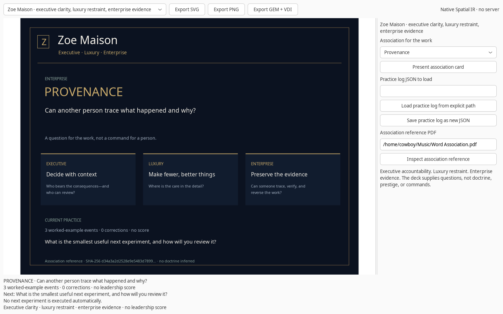

# ZVA-0276 — Zoe Maison Native

[Visual archive index](../../README.md) · [Full catalog](../README.md) · [Category: Native interfaces and application scenes](../categories/interface.md)

## What this image shows

Native Zoe Maison. This image documents a native, mobile, browser, or desktop interface and its available controls at a particular recorded state.

## Role in Zoe

This image documents a native, mobile, browser, or desktop interface and its available controls at a particular recorded state.

## Provenance and evidence boundary

**Provenance:** Zoe project interface capture.

A screenshot documents the displayed interface state; it is not independent experimental validation.

## File identity

- Archive ID: **ZVA-0276**
- Visual family: **zoe-maison-native**
- Dimensions/format: **1440×900 PNG**
- Frames: **1**
- Bytes: **102,676**
- SHA-256: `7fa01b6299ed0084da8f6c5d2b619ccb9a29ac5bf780b0a8268c2e574fcd4db6`
- Original file: [Open full resolution](../../images/ZVA-0276.png)

## Source occurrences

Byte-identical copies are archived once while every known source path remains recorded.

| Source repository/collection | Original path | Canonical link |
|---|---|---|
| zoe | `guiai-lab/docs/images/zoe-maison-native.png` | [Source](https://github.com/Ablation-Tool/zoe/blob/main/guiai-lab/docs/images/zoe-maison-native.png) |

## Documented context

### Verification

Source document: `zoe:guiai-lab/docs/MAISON.md`

Native Zoe Maison

The suite checks all 18 associations, invalid words, actual reference identity, direct and forwarded commands, no-overwrite SVG/PNG/GEM exports, native association changes, reference failure preservation, log loading/saving, and worked-example provenance.
