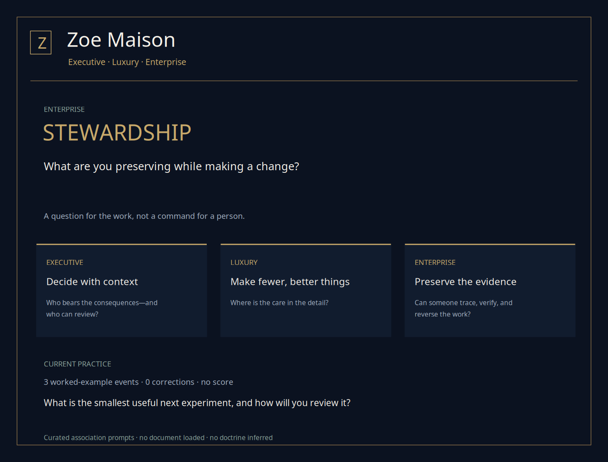

# ZVA-0277 — Zoe Maison

[Visual archive index](../../README.md) · [Full catalog](../README.md) · [Category: Artwork and generative compositions](../categories/artwork.md)

<a href="../../images/ZVA-0277.png"></a>

## What this image shows

Zoe Maison’s original design-studio and association deck, here presenting a stewardship prompt and response cards in its ink, pearl, and champagne palette. This is part of Zoe’s creative geometry and generative-art practice, preserving the artistic side of the project alongside its scientific instruments.

## Role in Zoe

This is part of Zoe’s creative geometry and generative-art practice, preserving the artistic side of the project alongside its scientific instruments.

## Provenance and evidence boundary

**Provenance:** Zoe/allgems project-generated visual.

The image is preserved with its source context; the visual alone does not prove a scientific or operational claim.

## File identity

- Archive ID: **ZVA-0277**
- Visual family: **zoe-maison**
- Dimensions/format: **1400×1064 PNG**
- Frames: **1**
- Bytes: **85,499**
- SHA-256: `27d57aa55b2a3b665b20fd55262aebe2db266fe68f47e5e3be42fa9cf2dfcdf4`
- Original file: [Open full resolution](../../images/ZVA-0277.png)

## Source occurrences

Byte-identical copies are archived once while every known source path remains recorded.

| Source repository/collection | Original path | Canonical link |
|---|---|---|
| zoe | `guiai-lab/docs/images/zoe-maison.png` | [Source](https://github.com/Ablation-Tool/zoe/blob/main/guiai-lab/docs/images/zoe-maison.png) |


## Documented context

### Creative and conceptual instruments

Source document: `zoe:README.md`

Zoe Maison

### Practice and adaptation

Source document: `zoe:guiai-lab/docs/VISUAL-GUIDES.md`

Executive clarity, luxury restraint, and enterprise evidence

Practice, advice, failure, learning, and adaptation{width=72%} **Zoe Maison**

### Verification

Source document: `zoe:guiai-lab/docs/MAISON.md`

Zoe Maison

python -m unittest stress.maison_stress -v ``` The suite checks all 18 associations, invalid words, actual reference identity, direct and forwarded commands, no-overwrite SVG/PNG/GEM exports, native association changes, reference failure preservation, log loading/saving, and worked-example provenance.

## Related format/size variants

- [ZVA-0278](ZVA-0278.md)
