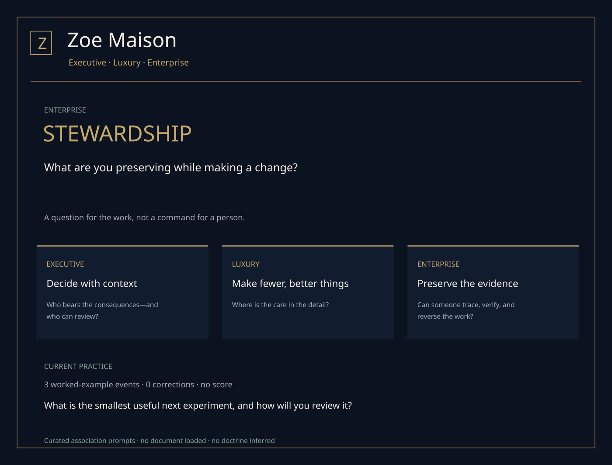

# ZVA-0278 — Zoe Maison

[Visual archive index](../../README.md) · [Full catalog](../README.md) · [Category: Artwork and generative compositions](../categories/artwork.md)

## What this image shows

Zoe Maison’s original design-studio and association deck, here presenting a stewardship prompt and response cards in its ink, pearl, and champagne palette. This is part of Zoe’s creative geometry and generative-art practice, preserving the artistic side of the project alongside its scientific instruments.

## Role in Zoe

This is part of Zoe’s creative geometry and generative-art practice, preserving the artistic side of the project alongside its scientific instruments.

## Provenance and evidence boundary

**Provenance:** Zoe/allgems project-generated visual.

The image is preserved with its source context; the visual alone does not prove a scientific or operational claim.

## File identity

- Archive ID: **ZVA-0278**
- Visual family: **zoe-maison**
- Dimensions/format: **SVG 1400×1064**
- Frames: **vector/not applicable**
- Bytes: **6,883**
- SHA-256: `cad4d00656e3d895ff7c9f50283039882ffab0ac0923cf5be2588d612a5c8fae`
- Original file: [Open full resolution](../../images/ZVA-0278.svg)

## Source occurrences

Byte-identical copies are archived once while every known source path remains recorded.

| Source repository/collection | Original path | Canonical link |
|---|---|---|
| zoe | `guiai-lab/docs/images/zoe-maison.svg` | [Source](https://github.com/Ablation-Tool/zoe/blob/main/guiai-lab/docs/images/zoe-maison.svg) |

## Related format/size variants

- [ZVA-0277](ZVA-0277.md)
