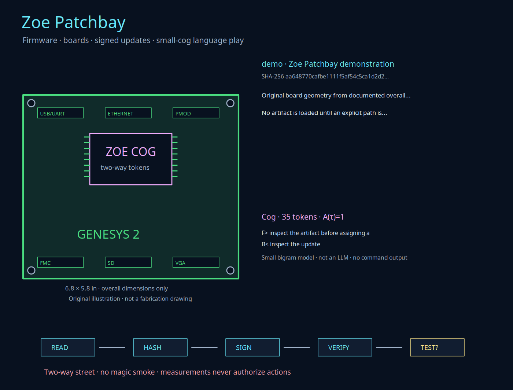

# ZVA-0280 — Zoe Patchbay

[Visual archive index](../../README.md) · [Full catalog](../README.md) · [Category: Research figures and measurements](../categories/research-figure.md)

<a href="../../images/ZVA-0280.png"></a>

## What this image shows

Zoe Patchbay. This visual belongs to Zoe’s CERN/source-evidence program, helping a reader inspect a corpus, protocol, replay, virtual system, or process boundary.

## Role in Zoe

This visual belongs to Zoe’s CERN/source-evidence program, helping a reader inspect a corpus, protocol, replay, virtual system, or process boundary.

## Provenance and evidence boundary

**Provenance:** Zoe/allgems project-generated visual.

The image is preserved with its source context; the visual alone does not prove a scientific or operational claim.

## File identity

- Archive ID: **ZVA-0280**
- Visual family: **zoe-patchbay**
- Dimensions/format: **1400×1064 PNG**
- Frames: **1**
- Bytes: **91,768**
- SHA-256: `4739a85cfbca0feb50d1ba9b7dcbf73b167cf0378455ed835b7ec676df991000`
- Original file: [Open full resolution](../../images/ZVA-0280.png)

## Source occurrences

Byte-identical copies are archived once while every known source path remains recorded.

| Source repository/collection | Original path | Canonical link |
|---|---|---|
| zoe | `guiai-lab/docs/images/zoe-patchbay.png` | [Source](https://github.com/Ablation-Tool/zoe/blob/main/guiai-lab/docs/images/zoe-patchbay.png) |
| zoe-autonomy | `paper/unified/figures/patchbay.png` | [Source](https://github.com/Ablation-Tool/Zoe-Autonomy/blob/main/paper/unified/figures/patchbay.png) |
| next-token | `paper/unified/figures/patchbay.png` | [Source](https://github.com/Ablation-Tool/next-token-predictability/blob/main/paper/unified/figures/patchbay.png) |
| paper-source-figures | `02-unified-autonomy/figures/patchbay.png` | [Source](https://github.com/Ablation-Tool/research-papers) |


## Documented context

### Native workbenches

Source document: `zoe:README.md`

Zoe Patchbay

### Geometry and evidence

Source document: `zoe:guiai-lab/docs/VISUAL-GUIDES.md`

Firmware, boards, signed updates, and Cog

Bounded VCD and legacy waveform replay{width=72%} **Zoe Patchbay**

### Verification

Source document: `zoe:guiai-lab/docs/PATCHBAY.md`

Zoe Patchbay

python -m unittest stress.cog_stress stress.patchbay_stress -v ``` The suites cover actual HEX, BIT, source ZIP, EMP, FIT, timing, source, and media inputs; Ed25519 signing and trust failures; dry-run and gated execution; process timeout and output bounds; report tampering; Cog training and forward/backward probabilities; direct and forwarded CLIs; and native inspection, Cog, validation, and export workflows. Optional local-evidence tests are skipped when their inputs or tools are unavailable.

## Related format/size variants

- [ZVA-0281](ZVA-0281.md)
