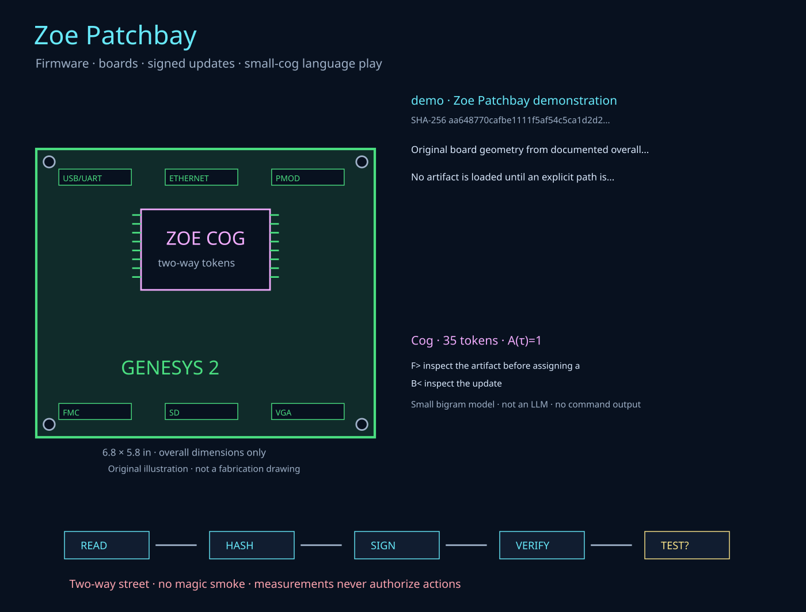

# ZVA-0281 — Zoe Patchbay

[Visual archive index](../../README.md) · [Full catalog](../README.md) · [Category: Research figures and measurements](../categories/research-figure.md)

## What this image shows

Zoe Patchbay is a research figures and measurements asset from the guiai-lab portion of the Zoe/allgems project. This visual belongs to Zoe’s CERN/source-evidence program, helping a reader inspect a corpus, protocol, replay, virtual system, or process boundary.

## Role in Zoe

This visual belongs to Zoe’s CERN/source-evidence program, helping a reader inspect a corpus, protocol, replay, virtual system, or process boundary.

## Provenance and evidence boundary

**Provenance:** Zoe/allgems project-generated visual.

The image is preserved with its source context; the visual alone does not prove a scientific or operational claim.

## File identity

- Archive ID: **ZVA-0281**
- Visual family: **zoe-patchbay**
- Dimensions/format: **SVG 1400×1064**
- Frames: **vector/not applicable**
- Bytes: **12,379**
- SHA-256: `6d48e27d27a7384315b538abf42764d9d7cfcdc61b640712a075f7711bf8bce4`
- Original file: [Open full resolution](../../images/ZVA-0281.svg)

## Source occurrences

Byte-identical copies are archived once while every known source path remains recorded.

| Source repository/collection | Original path | Canonical link |
|---|---|---|
| zoe | `guiai-lab/docs/images/zoe-patchbay.svg` | [Source](https://github.com/Ablation-Tool/zoe/blob/main/guiai-lab/docs/images/zoe-patchbay.svg) |

## Related format/size variants

- [ZVA-0280](ZVA-0280.md)
