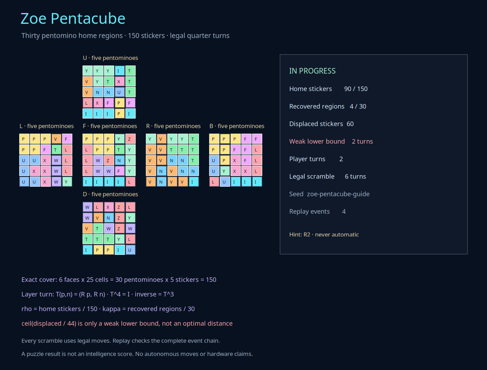

# ZVA-0283 — Zoe Pentacube

[Visual archive index](../../README.md) · [Full catalog](../README.md) · [Category: Research figures and measurements](../categories/research-figure.md)

## What this image shows

Zoe Pentacube. This figure preserves a measurement, model output, simulation, geometric construction, or research explanation from the Zoe/allgems program.

## Role in Zoe

This figure preserves a measurement, model output, simulation, geometric construction, or research explanation from the Zoe/allgems program.

## Provenance and evidence boundary

**Provenance:** Zoe/allgems project-generated visual.

The image is preserved with its source context; the visual alone does not prove a scientific or operational claim.

## File identity

- Archive ID: **ZVA-0283**
- Visual family: **zoe-pentacube**
- Dimensions/format: **1400×1064 PNG**
- Frames: **1**
- Bytes: **127,639**
- SHA-256: `f9eea05d7191bad018b6e27301ef21107ed39bcd2530b494c59d6dd364a9fd25`
- Original file: [Open full resolution](../../images/ZVA-0283.png)

## Source occurrences

Byte-identical copies are archived once while every known source path remains recorded.

| Source repository/collection | Original path | Canonical link |
|---|---|---|
| zoe | `guiai-lab/docs/images/zoe-pentacube.png` | [Source](https://github.com/Ablation-Tool/zoe/blob/main/guiai-lab/docs/images/zoe-pentacube.png) |
| zoe-autonomy | `paper/unified/figures/pentacube.png` | [Source](https://github.com/Ablation-Tool/Zoe-Autonomy/blob/main/paper/unified/figures/pentacube.png) |
| next-token | `paper/unified/figures/pentacube.png` | [Source](https://github.com/Ablation-Tool/next-token-predictability/blob/main/paper/unified/figures/pentacube.png) |
| paper-source-figures | `02-unified-autonomy/figures/pentacube.png` | [Source](https://github.com/Ablation-Tool/research-papers) |

## Documented context

### Native workbenches

Source document: `zoe:README.md`

Zoe Pentacube

### Replay and evidence

Source document: `zoe:guiai-lab/docs/PENTACUBE.md`

Zoe Pentacube scene

Undo applies an inverse permutation and appends an event; it does not delete history. Reset restores the recorded scramble and clears the player-move stack used for solving, while retaining earlier events. Digest checking provides tamper evidence, not authentication. Session and scene files never overwrite an existing destination. `docs/examples/pentacube-session.json` is a worked replay with two player turns remaining after an undo.

### Create and play

Source document: `zoe:guiai-lab/docs/VISUAL-GUIDES.md`

Pentomino regions and legal cube permutations

Zoe Artline vector study{width=48%} Zoe Pentomino completed board{width=48%} **Zoe Pentacube**

## Related format/size variants

- [ZVA-0284](ZVA-0284.md)
