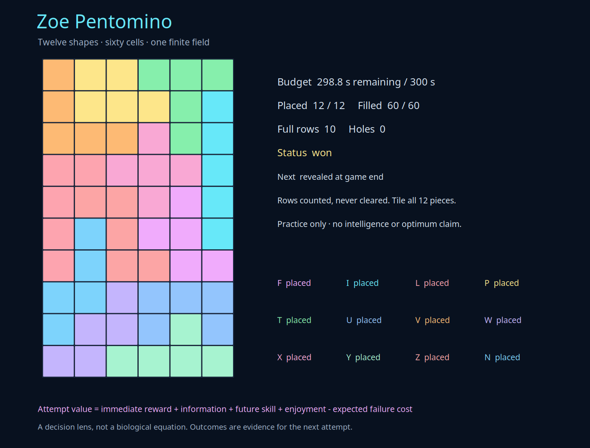

# ZVA-0286 — Zoe Pentomino

[Visual archive index](../../README.md) · [Full catalog](../README.md) · [Category: Research figures and measurements](../categories/research-figure.md)

## What this image shows

Zoe Pentomino completed board. This figure preserves a measurement, model output, simulation, geometric construction, or research explanation from the Zoe/allgems program.

## Role in Zoe

This figure preserves a measurement, model output, simulation, geometric construction, or research explanation from the Zoe/allgems program.

## Provenance and evidence boundary

**Provenance:** Zoe/allgems project-generated visual.

The image is preserved with its source context; the visual alone does not prove a scientific or operational claim.

## File identity

- Archive ID: **ZVA-0286**
- Visual family: **zoe-pentomino**
- Dimensions/format: **1400×1064 PNG**
- Frames: **1**
- Bytes: **92,601**
- SHA-256: `918e93fa408dfd2ea843db960f9a662f28d03b82c440cdc7861235a9520a6684`
- Original file: [Open full resolution](../../images/ZVA-0286.png)

## Source occurrences

Byte-identical copies are archived once while every known source path remains recorded.

| Source repository/collection | Original path | Canonical link |
|---|---|---|
| zoe | `guiai-lab/docs/images/zoe-pentomino.png` | [Source](https://github.com/Ablation-Tool/zoe/blob/main/guiai-lab/docs/images/zoe-pentomino.png) |

## Documented context

### Create and play

Source document: `zoe:guiai-lab/docs/VISUAL-GUIDES.md`

Zoe Pentomino completed board

**Zoe Artline · Zoe Pentomino**

## Related format/size variants

- [ZVA-0287](ZVA-0287.md)
