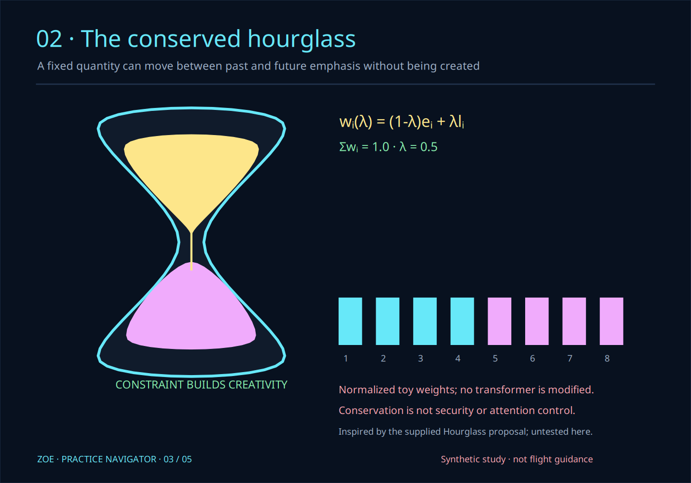

# ZVA-0290 — Zoe Pilot Hourglass

[Visual archive index](../../README.md) · [Full catalog](../README.md) · [Category: Research figures and measurements](../categories/research-figure.md)

## What this image shows

Original conserved-hourglass study. This figure preserves a measurement, model output, simulation, geometric construction, or research explanation from the Zoe/allgems program.

## Role in Zoe

This figure preserves a measurement, model output, simulation, geometric construction, or research explanation from the Zoe/allgems program.

## Provenance and evidence boundary

**Provenance:** Zoe/allgems project-generated visual.

The image is preserved with its source context; the visual alone does not prove a scientific or operational claim.

## File identity

- Archive ID: **ZVA-0290**
- Visual family: **zoe-pilot-hourglass**
- Dimensions/format: **1400×980 PNG**
- Frames: **1**
- Bytes: **104,484**
- SHA-256: `aac928ee97699b5a300c2a193fe8cb8bfc7f8cf593f7eb644f2b91f58ce308ca`
- Original file: [Open full resolution](../../images/ZVA-0290.png)

## Source occurrences

Byte-identical copies are archived once while every known source path remains recorded.

| Source repository/collection | Original path | Canonical link |
|---|---|---|
| zoe | `guiai-lab/docs/images/zoe-pilot-hourglass.png` | [Source](https://github.com/Ablation-Tool/zoe/blob/main/guiai-lab/docs/images/zoe-pilot-hourglass.png) |

## Documented context

### Hourglass boundary

Source document: `zoe:guiai-lab/docs/PILOT.md`

Original conserved-hourglass study

4. **Signals through the hourglass.** An original seven-layer network sketch and synthetic arrival-spacing measurements. 5. **Build Rome, then change the clock.** The verified twelve-piece tiling and controlled 1 / 5 / 20 / 300-second strategy comparison.

## Related format/size variants

- [ZVA-0291](ZVA-0291.md)
