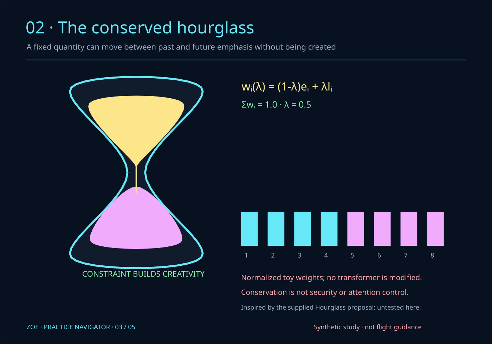

# ZVA-0291 — Zoe Pilot Hourglass

[Visual archive index](../../README.md) · [Full catalog](../README.md) · [Category: Research figures and measurements](../categories/research-figure.md)

## What this image shows

Zoe Pilot Hourglass is a research figures and measurements asset from the guiai-lab portion of the Zoe/allgems project. This figure preserves a measurement, model output, simulation, geometric construction, or research explanation from the Zoe/allgems program.

## Role in Zoe

This figure preserves a measurement, model output, simulation, geometric construction, or research explanation from the Zoe/allgems program.

## Provenance and evidence boundary

**Provenance:** Zoe/allgems project-generated visual.

The image is preserved with its source context; the visual alone does not prove a scientific or operational claim.

## File identity

- Archive ID: **ZVA-0291**
- Visual family: **zoe-pilot-hourglass**
- Dimensions/format: **SVG 1400×980**
- Frames: **vector/not applicable**
- Bytes: **8,545**
- SHA-256: `35a7d9297a32bae31665e24b628f1566d7754afcf3d1d31cbd826ea74f3050e8`
- Original file: [Open full resolution](../../images/ZVA-0291.svg)

## Source occurrences

Byte-identical copies are archived once while every known source path remains recorded.

| Source repository/collection | Original path | Canonical link |
|---|---|---|
| zoe | `guiai-lab/docs/images/zoe-pilot-hourglass.svg` | [Source](https://github.com/Ablation-Tool/zoe/blob/main/guiai-lab/docs/images/zoe-pilot-hourglass.svg) |

## Related format/size variants

- [ZVA-0290](ZVA-0290.md)
