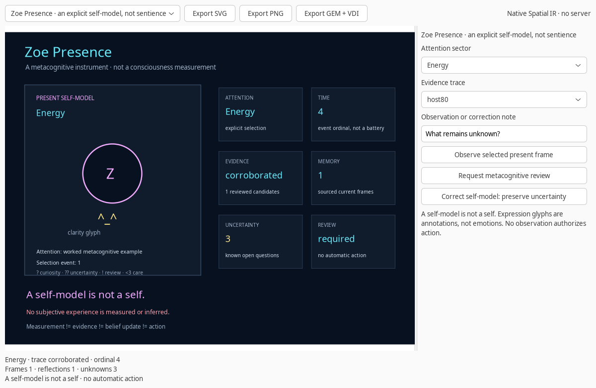

# ZVA-0300 — Zoe Presence Native

[Visual archive index](../../README.md) · [Full catalog](../README.md) · [Category: Native interfaces and application scenes](../categories/interface.md)

## What this image shows

Zoe Presence Native is a native interfaces and application scenes asset from the guiai-lab portion of the Zoe/allgems project. This image documents a native, mobile, browser, or desktop interface and its available controls at a particular recorded state.

## Role in Zoe

This image documents a native, mobile, browser, or desktop interface and its available controls at a particular recorded state.

## Provenance and evidence boundary

**Provenance:** Zoe project interface capture.

A screenshot documents the displayed interface state; it is not independent experimental validation.

## File identity

- Archive ID: **ZVA-0300**
- Visual family: **zoe-presence-native**
- Dimensions/format: **1200×780 PNG**
- Frames: **1**
- Bytes: **88,620**
- SHA-256: `62c9551acb8870745e4d2d38b0810f3d71d3d1e4c267259a24c7e9de92ebf105`
- Original file: [Open full resolution](../../images/ZVA-0300.png)

## Source occurrences

Byte-identical copies are archived once while every known source path remains recorded.

| Source repository/collection | Original path | Canonical link |
|---|---|---|
| zoe | `guiai-lab/docs/images/zoe-presence-native.png` | [Source](https://github.com/Ablation-Tool/zoe/blob/main/guiai-lab/docs/images/zoe-presence-native.png) |
