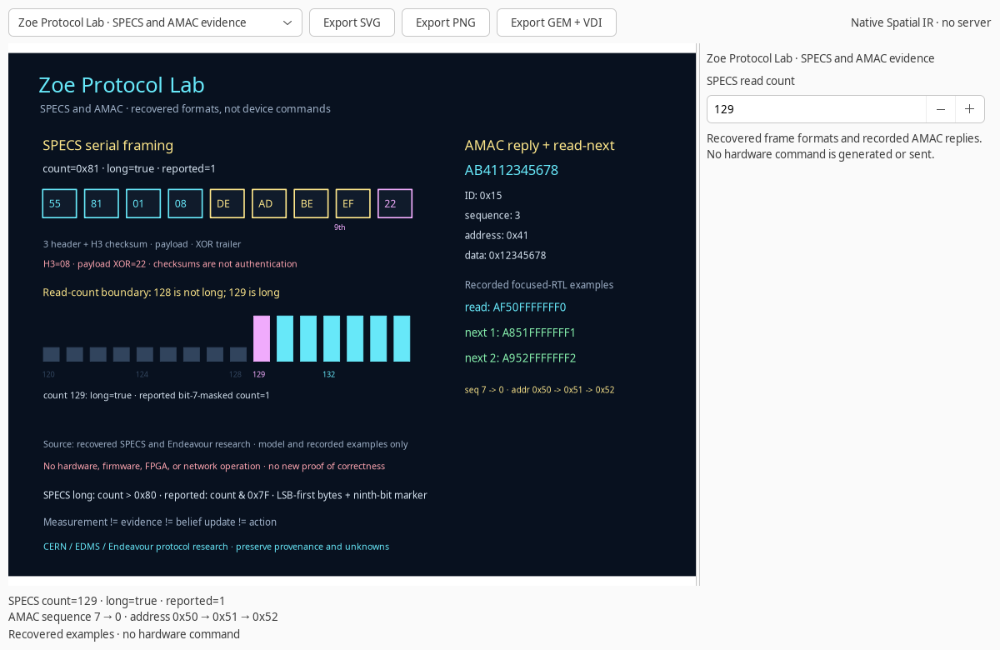

# ZVA-0303 — Zoe Protocol Native

[Visual archive index](../../README.md) · [Full catalog](../README.md) · [Category: Native interfaces and application scenes](../categories/interface.md)

## What this image shows

Zoe Protocol Native is a native interfaces and application scenes asset from the guiai-lab portion of the Zoe/allgems project. This visual belongs to Zoe’s CERN/source-evidence program, helping a reader inspect a corpus, protocol, replay, virtual system, or process boundary.

## Role in Zoe

This visual belongs to Zoe’s CERN/source-evidence program, helping a reader inspect a corpus, protocol, replay, virtual system, or process boundary.

## Provenance and evidence boundary

**Provenance:** Zoe project interface capture.

A screenshot documents the displayed interface state; it is not independent experimental validation.

## File identity

- Archive ID: **ZVA-0303**
- Visual family: **zoe-protocol-native**
- Dimensions/format: **1200×780 PNG**
- Frames: **1**
- Bytes: **93,134**
- SHA-256: `9d9745d1b8a83633c3bbc9f72a08b3cd06c53e9bd70b2c732c0d7e222ee4a626`
- Original file: [Open full resolution](../../images/ZVA-0303.png)

## Source occurrences

Byte-identical copies are archived once while every known source path remains recorded.

| Source repository/collection | Original path | Canonical link |
|---|---|---|
| zoe | `guiai-lab/docs/images/zoe-protocol-native.png` | [Source](https://github.com/Ablation-Tool/zoe/blob/main/guiai-lab/docs/images/zoe-protocol-native.png) |
